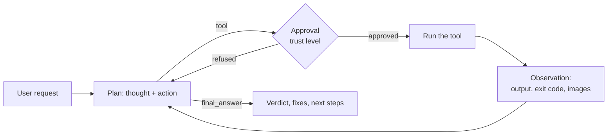

# Use case: SensaiUwu, the testing assistant

> **SensaiUwu is an assistant for every kind of testing.** It measures your coverage,
> writes your tests and fixes them with the frameworks you already use (GoogleTest,
> Criterion, pytest, cargo test…). It also tests any project **functionally**, by
> running it and looking at what it does: algorithms, graphics, web, networking and
> more.

This page describes the testing assistant and its usage scenarios. Feature sheets
detail each capability, its user stories and its role in the developer's workflow.

The feature sheets connect the scenario to user stories, current behavior and
recordings. Their captions identify what each recording demonstrates and distinguish
component execution from a complete conversation with the assistant.

---

## Reference scenario: Camille checks Atelier Nova's cart { #scenario-de-reference-camille-verifie-le-panier-datelier-nova }

Camille Moreau is a Python developer at **Atelier Nova**, a fictional small online
store. She is preparing a merge request for the cart calculation module. Malik
Benali, the developer reviewing the change, expects a test summary before reviewing
it: items priced at 10 and 20 must total 30, and an empty cart must total 0.

Camille uses Sensai in the terminal, from a local checkout, with a model served by
local Ollama. She wants to distinguish an actual passing suite from a regression,
without delegating production deployment or allowing uncontrolled file changes.
Demo amounts and customer-facing content are fictional; no real customer records
are used.

The workflow contains two independent situations:

| Situation | Demo project | Reference result |
| --- | --- | --- |
| Empty-cart regression | [Faulty version](demo_assets/demos/python-tests.md) | `1 failed, 1 passed`, exit code `1`; empty cart totals 1 instead of 0. |
| Correct calculation | [Correct version](demo_assets/demos/python-tests-passing.md) | `2 passed`, exit code `0`; empty cart totals 0 and the non-empty cart totals 30. |

Camille requests a test run, inspects the proposed command and decides whether to
approve it. Sensai uses the actual output to produce a concise summary. A failure
identifies the test and the observed mismatch; success confirms only the two covered
behaviors, not the whole application. Refusing an action prevents that call from
executing.

The review can also use the [fictional cart specification](demo_assets/demos/cart-spec.md),
a [local browser preview](use_cases/Browser.md), and a read-only rule server.
These extend the same workflow: identify the expectation, perform a check, inspect
its result and keep the developer in control.

This work takes place before code review, without an instant-response requirement.
A small module and two tests keep execution lightweight; local model inference adds
planning and response latency. Progress, proposed actions and streamed answers keep
Camille informed while she waits. The workflow is interactive development support,
not a production gate with a guaranteed response deadline.

The [ReAct loop](use_cases/ReAct.md) organizes execution and interpretation.
[Tools and trust levels](use_cases/Tools-and-trust-levels.md) determine which actions
require Camille's approval. Each feature sheet links its user stories and acceptance
criteria to this scenario.

*The people and company are fictional. This scenario and its user stories were
formalized on 26 October 2026; that date does not establish that they preceded
implementation.*

## Who it is for

Developers who want their project checked, not just discussed. A chatbot can tell you
*how* to test a Vulkan window or a REST endpoint; SensaiUwu **does it** on your machine:
it reads the project, runs it, observes the result (exit code, logs, screen, HTTP
response) and concludes with a verdict and, if something is wrong, a fix.

It covers two families of tests:

| Family | What SensaiUwu does | Typical tools |
|---|---|---|
| **Unit and integration tests** | Runs the suite, reads the failures, measures coverage, writes missing tests, fixes broken ones | GoogleTest, Criterion, pytest, cargo test, Jest, `gcovr`, `coverage.py`, `cargo llvm-cov` |
| **Functional tests** | Runs the program like a user would and checks the observable result | Shell commands, screenshots, logs, HTTP requests, sandboxed scripts |

Functional testing is what sets it apart: some projects have no test framework at all
(a game engine window, a network server, a sorting algorithm handed in as a binary),
and still need to be checked.

| Domain | Example of a functional test |
|---|---|
| **Algorithms** | Run a solver on generated inputs, compare its output with a reference implementation, time it |
| **Graphics** | Launch a Vulkan/OpenGL/SFML app, take a screenshot, check the window opened and the terminal shows no validation error |
| **Web** | Start a server in the background, fetch its pages or call its API, check the answers |
| **Networking** | Start a server and a client, check they connect and exchange the expected messages |

---

## How it works

Each message goes through a **ReAct loop** (Thought → Action → Observation): the model
thinks, picks one tool, sees its result, and starts again until it has enough to reply.
The code, not the model, validates each step and enforces the budgets.



A testing session therefore looks like a tester's work: **read** (how is this project
run?), **act** (build, run, capture), **observe** (logs, screen, files), **conclude**
(it works / it fails because…), **fix** (edit the code or the tests) and **check again**.

---

## Additional scenario: does Ethan's Vulkan window open? { #flagship-scenario-does-ethans-vulkan-window-open }

Ethan wrote a Vulkan application for his engine. He wants to
know whether its window opens correctly and without errors. There is no test framework
for that: it has to be run and looked at.

The following steps illustrate a possible workflow; the JSON and answer excerpts
are examples, rather than observations from the cart recordings.

**Ethan:**
> Check that my engine's window opens without errors.

**1. Read how the project runs.** The model doesn't guess the command: it reads the
project's instructions.

```json
{"thought": "I need to know how this project is built and run.",
 "action": "file_read", "args": {"file_path": "README.md"}}
```

The README says `xmake run`. The file is also ingested into the session's RAG, so the
next messages can rely on it without reading it again.

**2. Run it in the background.** A graphical app never exits on its own: run in the
foreground, it would hit the 30-second timeout. The model starts it as a background
job and gets a `job_id` at once.

```json
{"thought": "The app opens a window and keeps running: start it as a job.",
 "action": "bash_tool", "args": {"command": "xmake run", "background": true}}
```

**3. Look at the screen.** The model takes a screenshot; the image is shown to it
directly (vision models only).

```json
{"thought": "The window should be open now; let me see the screen.",
 "action": "screenshot", "args": {}}
```

**4. Read the terminal.** It checks the job: still running, and the end of its output,
where validation layer errors and crashes appear.

```json
{"thought": "Check the logs for Vulkan validation errors.",
 "action": "bash_job", "args": {"job_id": "job_1"}}
```

**5. Conclude, and fix if needed.** The model crosses both observations and answers:

> The window opens: the screenshot shows a 1280×720 window titled "Engine" with the
> clear color. However, the terminal shows a validation error:
> `VUID-vkCmdDraw-None-08600: descriptor set 0 is not bound`. The pipeline is bound,
> but `vkCmdBindDescriptorSets` is never called before `vkCmdDraw` in
> `src/render/frame.cpp`. Add the bind right after `vkCmdBindPipeline`. Do you want
> me to make the change and run the test again?

On Ethan's "yes", the model edits the file with `file_write`, runs `xmake run` again
and checks that the error is gone. That's a complete test cycle: **read → run →
observe → conclude → fix → check again**.

!!! note "Budgets"
    This scenario uses 4 tool calls in one message, within the ReAct loop's budgets
    (10 tool calls and 10 steps per message, see [Current limits](#current-limits)).

---

## Features

| Feature | Role in the testing assistant |
|---|---|
| [ReAct loop](use_cases/ReAct.md) | Turns a request into a test procedure: read, act, observe, conclude |
| [Tools and trust levels](use_cases/Tools-and-trust-levels.md) | Lets the model act on the machine, under the user's control |
| [Bash: `bash_tool` and `bash_job`](use_cases/Bash.md) | Builds, runs test suites, launches programs and servers |
| [File access: `file_read` and `file_write`](use_cases/File-access.md) | Reads the code and the test reports, writes tests and fixes |
| [Screenshot](use_cases/Screenshot.md) | Observes graphical output |
| [Browser](use_cases/Browser.md) | Tests websites and web apps like a user: open, read, click, type |
| [Sandboxed code](use_cases/Sandboxed-code.md) | Runs throwaway or risky code away from the host |
| [Web search and web fetch](use_cases/Web-search-and-fetch.md) | Finds documentation, checks deployed pages |
| [MCP servers](use_cases/MCP.md) | Plugs in external tools: GitHub, browsers, databases… |
| [RAG on documents](use_cases/RAG.md) | Remembers specs, READMEs and reports across messages |
| [Session compression](use_cases/Session-compression.md) | Keeps long debugging sessions within the context window |
| [Profiles, preferences and instructions](use_cases/Profiles.md) | Remembers how *you* test |
| [Personas](use_cases/Personas.md) | Adapts the agent's role and tone |
| [Models and capabilities](use_cases/Models-and-capabilities.md) | Picks the right model, hides tools it can't use |
| [Feature flags and settings](use_cases/Feature-flags-and-settings.md) | Switches capabilities on and off |
| [Streaming and event-driven UI](use_cases/Streaming-and-UI.md) | Shows the reasoning live, keeps the core UI-agnostic |

`get_temperature` is an example tool showing the tool interface; it plays no part in
the testing use case.

---

## Current limits

| Limit | Value | Impact |
|---|---|---|
| Successful tool calls per message | 10 in total, 2 per tool | Longer interaction sequences can exceed the per-tool budget |
| Planned steps per message | 10 (`DEFAULT_MAX_STEPS`) | Long procedures are split across several messages |
| Observation kept for the model | 6,000 characters | Long outputs may be truncated before analysis |
| Foreground command | 30 s | Use `background: true` for builds, apps and servers |
| Screenshot | Vision model and a display needed | No visual check on a headless machine |
| Host Bash | Runs with the user's rights | Keep the trust level at `none` or `partial` on sensitive machines |
| Browser | Google Chrome and a display for the normal launcher | The component recording uses a preopened portable Chromium page |
| Web lookup | External API and separate `API_TOKEN` required | The recorded case shows unavailable lookup without a token |
| Compression | Model-generated, potentially lossy summary | Short summaries can grow and introduce unsupported test claims |
| RAG | Compatible embedding model and extractable documents | Retrieved excerpts do not prove answer quality or full requirement coverage |
| Saved sessions | SQLite history; a new session at startup, earlier ones reopened with [`/session`](use_cases/Sessions.md) | Automatic titles are model-generated and can be vague |
