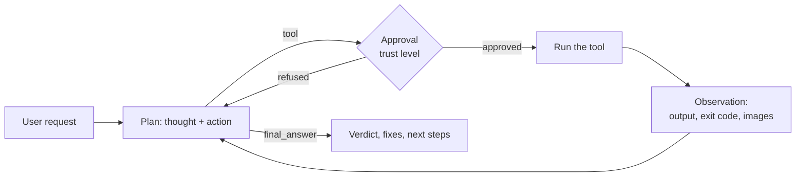

# Use case: SensaiUwu, the testing assistant

> **SensaiUwu is an assistant for every kind of testing.** It measures your coverage,
> writes your tests and fixes them with the frameworks you already use (GoogleTest,
> Criterion, pytest, cargo test…). It also tests any project **functionally**, by
> running it and looking at what it does: algorithms, graphics, web, networking and
> more.

This page describes this use case, then every feature of Sensai: what it does, why the
testing assistant needs it, and a concrete scenario showing it at work.

---

## Who it is for

Developers who want their project checked, not just discussed. A chatbot can tell you
*how* to test a Vulkan window or a REST endpoint; SensaiUwu **does it** on your machine:
it reads the project, runs it, observes the result (exit code, logs, screen, HTTP
response) and concludes with a verdict and, if something is wrong, a fix.

It covers two families of tests:

| Family | What SensaiUwu does | Typical tools |
|---|---|---|
| **Unit and integration tests** | Runs the suite, reads the failures, measures coverage, writes missing tests, fixes broken ones | GoogleTest, Criterion, pytest, cargo test, Jest, `gcovr`, `coverage.py`, `cargo llvm-cov` |
| **Functional tests** | Runs the program like a user would and checks the observable result | Shell commands, screenshots, logs, HTTP requests, sandboxed scripts |

Functional testing is what sets it apart: some projects have no test framework at all
(a game engine window, a network server, a sorting algorithm handed in as a binary),
and still need to be checked.

| Domain | Example of a functional test |
|---|---|
| **Algorithms** | Run a solver on generated inputs, compare its output with a reference implementation, time it |
| **Graphics** | Launch a Vulkan/OpenGL/SFML app, take a screenshot, check the window opened and the terminal shows no validation error |
| **Web** | Start a server in the background, fetch its pages or call its API, check the answers |
| **Networking** | Start a server and a client, check they connect and exchange the expected messages |

---

## How it works

Each message goes through a **ReAct loop** (Thought → Action → Observation): the model
thinks, picks one tool, sees its result, and starts again until it has enough to reply.
The code, not the model, validates each step and enforces the budgets.



A testing session therefore looks like a tester's work: **read** (how is this project
run?), **act** (build, run, capture), **observe** (logs, screen, files), **conclude**
(it works / it fails because…), **fix** (edit the code or the tests) and **check again**.

---

## Flagship scenario: does Ethan's Vulkan window open?

Ethan wrote a Vulkan application for his engine (the best of all time). He wants to
know whether its window opens correctly and without errors. There is no test framework
for that: it has to be run and looked at.

**Ethan:**
> Check that my engine's window opens without errors.

**1. Read how the project runs.** The model doesn't guess the command: it reads the
project's instructions.

```json
{"thought": "I need to know how this project is built and run.",
 "action": "file_read", "args": {"file_path": "README.md"}}
```

The README says `xmake run`. The file is also ingested into the session's RAG, so the
next messages can rely on it without reading it again.

**2. Run it in the background.** A graphical app never exits on its own: run in the
foreground, it would hit the 30-second timeout. The model starts it as a background
job and gets a `job_id` at once.

```json
{"thought": "The app opens a window and keeps running: start it as a job.",
 "action": "bash_tool", "args": {"command": "xmake run", "background": true}}
```

**3. Look at the screen.** The model takes a screenshot; the image is shown to it
directly (vision models only).

```json
{"thought": "The window should be open now; let me see the screen.",
 "action": "screenshot", "args": {}}
```

**4. Read the terminal.** It checks the job: still running, and the end of its output,
where validation layer errors and crashes appear.

```json
{"thought": "Check the logs for Vulkan validation errors.",
 "action": "bash_job", "args": {"job_id": "job_1"}}
```

**5. Conclude, and fix if needed.** The model crosses both observations and answers:

> The window opens: the screenshot shows a 1280×720 window titled "Engine" with the
> clear color. However, the terminal shows a validation error:
> `VUID-vkCmdDraw-None-08600: descriptor set 0 is not bound`. The pipeline is bound,
> but `vkCmdBindDescriptorSets` is never called before `vkCmdDraw` in
> `src/render/frame.cpp`. Add the bind right after `vkCmdBindPipeline`. Do you want
> me to make the change and run the test again?

On Ethan's "yes", the model edits the file with `file_write`, runs `xmake run` again
and checks that the error is gone. That's a complete test cycle: **read → run →
observe → conclude → fix → check again**.

!!! note "Budgets"
    This scenario uses 4 tool calls in one message. The ReAct loop currently allows
    3 per message by default (see [Current limits](#current-limits)), so the default
    budgets must be raised for it to run in one go.

---

## Features

| Feature | Role in the testing assistant |
|---|---|
| [ReAct loop](#react-loop) | Turns a request into a test procedure: read, act, observe, conclude |
| [Tools and trust levels](#tools-and-trust-levels) | Lets the model act on the machine, under the user's control |
| [Bash: `bash_tool` and `bash_job`](#bash-bash_tool-and-bash_job) | Builds, runs test suites, launches programs and servers |
| [File access: `file_read` and `file_write`](#file-access-file_read-and-file_write) | Reads the code and the test reports, writes tests and fixes |
| [Screenshot](#screenshot) | Observes graphical output |
| [Sandboxed code](#sandboxed-code) | Runs throwaway or risky code away from the host |
| [Web search and web fetch](#web-search-and-web-fetch) | Finds documentation, checks deployed pages |
| [MCP servers](#mcp-servers) | Plugs in external tools: GitHub, browsers, databases… |
| [RAG on documents](#rag-on-documents) | Remembers specs, READMEs and reports across messages |
| [Session compression](#session-compression) | Keeps long debugging sessions within the context window |
| [Profiles, preferences and instructions](#profiles-preferences-and-instructions) | Remembers how *you* test |
| [Personas](#personas) | Adapts the agent's role and tone |
| [Models and capabilities](#models-and-capabilities) | Picks the right model, hides tools it can't use |
| [Feature flags and settings](#feature-flags-and-settings) | Switches capabilities on and off |
| [Streaming and event-driven UI](#streaming-and-event-driven-ui) | Shows the reasoning live, keeps the core UI-agnostic |

### ReAct loop

**What it is.** For each message, the model proposes one step at a time as JSON
(`thought`, `action`, `args`), constrained by a schema listing the actions still
allowed. The controller (`sensai/features/react/react.py`) checks each step (unknown
tool, missing or mistyped arguments, exact repeated call) and replays the trajectory
to the model, so the last thing it reads is the last observation. Servers that ignore
the schema (e.g. Ollama Cloud) are detected, and the JSON shape is then spelled out in
the instructions instead.

**Why it matters.** Testing is never a single action: you need to look before acting,
and react to what you see. The loop is what lets the agent decide "the build failed,
let me read the error" instead of answering blindly. The budgets keep a small model
from looping forever on the same call.

**Use case.** *"Why does `make test` fail?"* The model runs `make test`, sees a
compilation error in `tests/test_list.c`, reads that file, finds a test calling a
function renamed in the last commit, and explains it.

### Tools and trust levels

**What it is.** Every tool declares whether it is `safe` (read-only, harmless). The
user picks a trust level in `/settings`:

| Trust level | Behavior |
|---|---|
| `none` | Every tool call asks for approval |
| `partial` | Safe tools run on their own; the others ask |
| `total` | Everything runs without asking |

A refused call doesn't stop the loop: the model sees the refusal and adapts.

**Why it matters.** A tester runs commands and edits files on your machine. You stay
in control of what actually runs, and can loosen it once you trust the workflow.

**Use case.** In `partial`, checking a job (`bash_job`, safe) runs without asking, but
`bash_tool` with `rm -rf build && xmake` asks for approval first.

### Bash: `bash_tool` and `bash_job`

**What it is.** `bash_tool` runs a command on the host. In the foreground it waits at
most 30 s and returns the exit code and the end of the output (the last 8,000
characters, where a build's errors are). With `background: true` it starts a job and
returns its `job_id` at once. `bash_job` checks a job: still running or not, its exit
code, the end of its log; it can wait for the job to finish (up to 120 s) or stop it
along with everything it launched. Every job is stopped when Sensai exits.

**Why it matters.** This is how SensaiUwu reaches every test framework without a
dedicated integration: `pytest`, `ctest`, `cargo test`, `criterion` binaries,
`gcovr`, `npm test` are all commands. Background jobs cover what never exits on its
own: GUI apps, servers, long builds.

**Use case.** *"What's my coverage?"* on a Rust project: the model starts
`cargo llvm-cov --summary-only` in the background, waits for it with
`bash_job` (`wait_seconds: 120`), and reports the per-file coverage with the least
covered functions to test first.

### File access: `file_read` and `file_write`

**What it is.** `file_read` reads a text file, after checking it exists and is
readable; the file is also ingested into the session's RAG. `file_write` writes a file
(creating or overwriting it), after checking the target is writable and its folder
exists.

**Why it matters.** Writing and fixing tests means reading the code under test and
editing test files. Reading also covers what the tools produce: JUnit XML reports,
`coverage.xml`, logs.

**Use case.** *"Write the missing tests for `src/parser.py`."* The model reads the
module, reads the existing `tests/test_parser.py` to follow its style, writes the new
tests with `file_write`, then runs `pytest tests/test_parser.py` to check they pass.

### Screenshot

**What it is.** `screenshot` captures the screen, downscaled to 1920×1080, and shows
the image to the model directly. It requires a model with vision: for other models the
tool is hidden.

**Why it matters.** Some results only exist on screen: a window, a rendering, a UI
layout. Without eyes, the agent can only check that the program didn't crash.

**Use case.** The [flagship scenario](#flagship-scenario-does-ethans-vulkan-window-open):
the screenshot proves the window opened and shows the expected render, which logs
alone can't.

### Sandboxed code

**What it is.** `sandboxed_code` runs Python or Bash in a disposable Docker container:
no network, read-only filesystem, half a CPU, 512 MB of memory, 64 processes, a 20 s
limit, and the container is removed afterwards.

**Why it matters.** Testing algorithms often means writing throwaway code: a reference
implementation, an input generator, a fuzzer. The sandbox runs it without risk for the
host, and is the place for any command that could be destructive.

**Use case.** *"Is my `fast_sort` correct?"* The model writes a Python script that
generates 1,000 random arrays (empty, sorted, reversed, with duplicates), compares
`fast_sort` with `sorted` on each and prints the first counterexample. It runs it in
the sandbox.

### Web search and web fetch

**What it is.** `web_search` searches the web, `web_fetch` reads a given page, both
through Ollama's web API (an `API_TOKEN` is needed).

**Why it matters.** Test failures often come with cryptic messages from tools the user
doesn't know by heart. And for web projects, `web_fetch` checks a deployed page's
content.

**Use case.** A GoogleTest suite fails with `TYPED_TEST_SUITE_P is defined but not
registered`. The model searches for it, finds that the suite must be instantiated with
`INSTANTIATE_TYPED_TEST_SUITE_P`, and adds the missing line.

### MCP servers

**What it is.** `/mcp add-json <name> '<json>'` connects an MCP server during a
conversation, and its tools become the agent's tools (see
[MCP connections](mcp-server.md)).

**Why it matters.** It extends the tester without writing code: a GitHub server to read
an issue or a PR, a browser server (e.g. Playwright MCP) to click through a web app, a
database server to check what a test wrote.

**Use case.** *"Reproduce issue #42."* With GitHub's MCP server connected, the model
reads the issue's steps, runs them with `bash_tool`, and confirms or refutes the bug
with the actual output.

### RAG on documents

**What it is.** Documents (text, Markdown, HTML, PDF, DOCX…) are converted to Markdown,
split into chunks and embedded with `nomic-embed-text`. For each prompt, the most
relevant chunks are added to the context. Documents come from `--files` at startup, or
from the files the agent reads with `file_read`.

**Why it matters.** Testing against a spec: the expected behavior is in a PDF subject,
an RFC or a README. RAG lets the model check the program against it without the whole
document in every prompt.

**Use case.** Started with `--files subject.pdf`, the user asks *"Does my server follow
the protocol?"* The relevant protocol section is retrieved, and the model checks the
server's responses against each command it describes.

### Session compression

**What it is.** Once a prompt goes over a token threshold (3,000 by default,
`--compression-threshold`), the history is folded into a running summary by the same
model.

**Why it matters.** A debugging session goes through many rounds of run, read, fix,
run again. Compression keeps it going without overflowing a small model's context, and
keeps the decisions made along the way.

**Use case.** After an hour of fixing a flaky network test, the summary still holds
"the failure only happens when the client connects before `listen()`; a retry with
backoff was added in `client.c`", so the model doesn't suggest that fix again.

### Profiles, preferences and instructions

**What it is.** Users log in to a profile. `/prefs` and `/inst` store preferences and
instructions added to every conversation; sessions and their history are saved in a
SQLite database.

**Why it matters.** Every developer tests differently. Saying once "use pytest with
`-q`", "my C tests use Criterion" or "never touch `src/legacy/`" saves repeating it, and
avoids a fix in the wrong place.

**Use case.** With the instruction *"Run tests with `uv run pytest -q`"*, the model
never tries a bare `pytest` that would miss the virtual environment.

### Personas

**What it is.** A persona is a name, a description and a system prompt, defined in
`personas.json`, picked with `--persona` or `/persona switch`.

**Why it matters.** The system prompt sets the agent's role. A dedicated testing
persona can set the method (always reproduce before fixing, always run the tests
again after a fix) and the report format.

**Use case.** A "QA" persona that ends every answer with a summary table: test, result,
evidence (log line or screenshot), suggested fix.

### Models and capabilities

**What it is.** `--model` and `/model` choose the Ollama model. Sensai asks Ollama what
the model can do: tools needing a missing capability are hidden (the screenshot needs
`vision`), and images are never sent to a model that can't see them.

**Why it matters.** Testing a GUI needs a vision model; a quick unit-test fix runs fine
on a small one. The agent never offers a tool the current model can't use.

**Use case.** On `llama3.2` (no vision), the screenshot tool isn't offered; the model
checks the Vulkan app through its logs only, and suggests switching to a vision model
to check the render.

### Feature flags and settings

**What it is.** Each feature (`tools`, `react`, `rag`, `compression`, `mcp`) and each
tool can be switched off: `--disable` and `--disable-tool` at startup, `/settings` and
`/tools enable|disable` at runtime.

**Why it matters.** Restrict the tester to what a task needs: no web access for a
confidential project, no `bash_tool` when only the sandbox should run code.

**Use case.** For an exam project, `--disable-tool web_search --disable-tool web_fetch`
ensures the analysis relies only on the local code and tests.

### Streaming and event-driven UI

**What it is.** The agent's thoughts and the final answer are streamed as they are
generated. The core talks to the interface through events (see
[Event System & UI](events.md)), so the same agent can drive the terminal UI or a future
web UI.

**Why it matters.** A test run takes several steps: seeing the reasoning live ("the
build passed, now checking the logs") shows what the agent is doing and lets the user
stop it early if it goes the wrong way.

**Use case.** While a long `cargo test` runs in the background, the user follows each
step: the command, the job check, the failing test, the analysis.

---

## Current limits

| Limit | Value | Impact |
|---|---|---|
| Tool calls per message | 3 in total, 2 per tool | The flagship scenario needs 4 calls: raise `DEFAULT_MAX_TOOL_CALLS` |
| Planned steps per message | 5 (`DEFAULT_MAX_STEPS`) | Long procedures are split across several messages |
| Observation kept for the model | 4,000 characters | Long logs are truncated; ask for a targeted `grep` |
| Foreground command | 30 s | Use `background: true` for builds, apps and servers |
| Screenshot | Vision model and a display needed | No visual check on a headless machine |
| Host Bash | Runs with the user's rights | Keep the trust level at `none` or `partial` on sensitive machines |
| Web browsing | No built-in browser | Connect a browser MCP server (e.g. Playwright MCP) |

`get_temperature` is an example tool showing the tool interface; it plays no part in
the testing use case.
