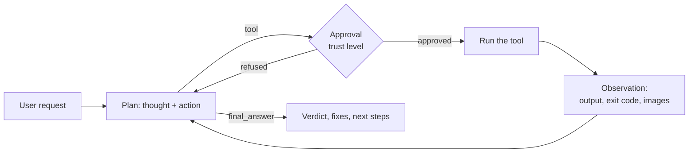

# Use case: SensaiUwu, the testing assistant

> **SensaiUwu helps a small development team check code before review, with the model
> running on the company's own server.** It runs the project's tests, observes the
> result, explains a failure and, with the developer's approval, applies a fix and checks
> again. Web tools, MCP servers and cloud models can send data elsewhere: see
> [where data goes](responsibility.md).

This page describes the testing assistant and its usage scenarios. Feature sheets
detail each capability, its user stories and its role in the developer's workflow.

The feature sheets connect the scenario to user stories, current behavior and
recordings. Their captions identify what each recording demonstrates and distinguish
component execution from a complete conversation with the assistant.

---

## Reference scenario: Camille checks Atelier Nova's cart { #scenario-de-reference-camille-verifie-le-panier-datelier-nova }

Camille Moreau is a Python developer at **Atelier Nova**, a fictional small online
store. She is preparing a merge request for the cart calculation module. Malik
Benali, the developer reviewing the change, expects a test summary before reviewing
it: items priced at 10 and 20 must total 30, and an empty cart must total 0.

Atelier Nova runs Ollama on a GPU server of its own, shared by its small development
team, so inference on its code and logs stays inside the company. Camille uses SensaiUwu in the
terminal, from a local checkout, pointed at that server with `--url`. In the live
demonstration, an RTX 4090 machine plays the role of this server. She wants to distinguish an actual passing suite from a regression,
without delegating production deployment or allowing uncontrolled file changes.
Demo amounts and customer-facing content are fictional; no real customer records
are used.

The workflow is built on two situations:

| Situation | Demo project | Reference result |
| --- | --- | --- |
| Empty-cart regression | [Faulty version](demo_assets/demos/python-tests.md) | `1 failed, 1 passed`, exit code `1`; empty cart totals 1 instead of 0. |
| Correct calculation | [Correct version](demo_assets/demos/python-tests-passing.md) | `2 passed`, exit code `0`; empty cart totals 0 and the non-empty cart totals 30. |

Camille requests a test run, inspects the proposed command and decides whether to
approve it. SensaiUwu uses the actual output to produce a concise summary. A failure
identifies the test and the observed mismatch; success confirms only the two covered
behaviors, not the whole application. Refusing an action prevents that call from
executing. After a failure, Camille can approve a [correction](use_cases/File-access.md)
and have the same tests run again, so the summary she gives Malik rests on the fixed
code.

The review can also use the [fictional cart specification](demo_assets/demos/cart-spec.md),
a [local browser preview](use_cases/Browser.md), and a read-only rule server.
These extend the same workflow: identify the expectation, perform a check, inspect
its result and keep the developer in control.

This work takes place before code review, without an instant-response requirement.
A small module and two tests keep execution lightweight; model inference on the shared
server adds planning and response latency. Progress, proposed actions and streamed answers keep
Camille informed while she waits. The workflow is interactive development support,
not a production gate with a guaranteed response deadline.

The [ReAct loop](use_cases/ReAct.md) organizes execution and interpretation.
[Tools and trust levels](use_cases/Tools-and-trust-levels.md) determine which actions
require Camille's approval. Each feature sheet links its user stories and acceptance
criteria to this scenario.

*The people and company are fictional. This scenario and its user stories were
formalized on 26 October 2026; that date does not establish that they preceded
implementation.*

## How it works

Each message goes through a **ReAct loop** (Thought → Action → Observation): the model
thinks, picks one tool, sees its result, and starts again until it has enough to reply.
The code, not the model, validates each step and enforces the budgets.

A testing session therefore looks like a tester's work: **read** (how is this project
run?), **act** (build, run, capture), **observe** (logs, screen, files), **conclude**
(it works / it fails because…), **fix** (edit the code or the tests) and **check again**.

---

## Features

| Feature | Role in the testing assistant |
| --- | --- |
| [ReAct loop](use_cases/ReAct.md) | Turns a request into a test procedure: read, act, observe, conclude |
| [Tools and trust levels](use_cases/Tools-and-trust-levels.md) | Lets the model act on the machine, under the user's control |
| [Bash: `bash_tool` and `bash_job`](use_cases/Bash.md) | Runs the test suite and longer checks |
| [File access: `file_read` and `file_write`](use_cases/File-access.md) | Reads the code and the test reports, writes tests and fixes |
| [Screenshot](use_cases/Screenshot.md) | Observes what is on screen, such as the local preview |
| [Browser](use_cases/Browser.md) | Tests websites and web apps like a user: open, read, click, type |
| [Sandboxed code](use_cases/Sandboxed-code.md) | Runs throwaway or risky code away from the host |
| [Web search and web fetch](use_cases/Web-search-and-fetch.md) | Finds documentation for a failing check |
| [MCP servers](use_cases/MCP.md) | Plugs in external tools, such as the read-only rule server of the review |
| [RAG on documents](use_cases/RAG.md) | Remembers the cart specification and reports across messages |
| [Session compression](use_cases/Session-compression.md) | Keeps long review sessions within the context window |
| [Profiles, preferences and instructions](use_cases/Profiles.md) | Remembers how Camille tests |
| [Personas](use_cases/Personas.md) | Adapts the agent's role and tone |
| [Models and capabilities](use_cases/Models-and-capabilities.md) | Picks the right model, hides tools it can't use |
| [Feature flags and settings](use_cases/Feature-flags-and-settings.md) | Switches capabilities on and off |
| [Streaming and event-driven UI](use_cases/Streaming-and-UI.md) | Shows the reasoning live, keeps the core UI-agnostic |

`get_temperature` is an example tool showing the tool interface; it plays no part in
the testing use case.

---

## Current limits

| Limit | Value | Impact |
| --- | --- | --- |
| Successful tool calls per message | 10 in total, 2 per tool | Longer interaction sequences can exceed the per-tool budget |
| Planned steps per message | 10 (`DEFAULT_MAX_STEPS`) | Long procedures are split across several messages |
| Observation kept for the model | 6,000 characters | Long outputs may be truncated before analysis |
| Foreground command | 30 s | Use `background: true` for builds, apps and servers |
| Screenshot | Vision model and a display needed | No visual check on a headless machine |
| Host Bash | Runs with the user's rights | Keep the trust level at `none` or `partial` on sensitive machines |
| Browser | Google Chrome and a display for the normal launcher | The component recording uses a preopened portable Chromium page |
| Web lookup | External API and separate `API_TOKEN` required | The recorded case shows unavailable lookup without a token |
| Compression | Model-generated, potentially lossy summary | Short summaries can grow and introduce unsupported test claims |
| RAG | Compatible embedding model and extractable documents | Retrieved excerpts do not prove answer quality or full requirement coverage |
| Saved sessions | SQLite history; a new session at startup, earlier ones reopened with [`/session`](use_cases/Sessions.md) | Automatic titles are model-generated and can be vague |
