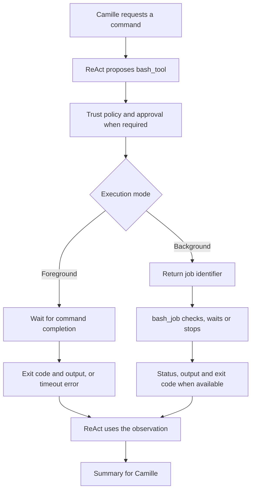
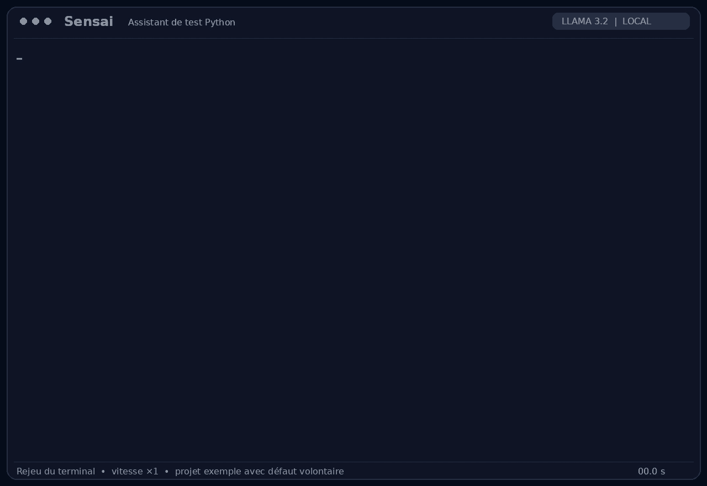

# Bash: `bash_tool` and `bash_job`

Sensai uses Bash tools to build projects, run test suites and launch programs
or local servers. `bash_tool` starts a command; `bash_job` monitors or stops a
command started as a background job. This gives the testing assistant access
to existing development tools without a separate integration for each framework.

## Scenario: Camille runs the cart checks before review

Camille Moreau, a Python developer at Atelier Nova, is preparing the cart module
for Malik Benali's review. She already has pytest tests and wants Sensai to run
them in her local checkout, then report whether the covered behaviors pass.
She does not want to replace her test framework or copy terminal output into
a separate chatbot.

In the [reference scenario](../use-case.md#scenario-de-reference-camille-verifie-le-panier-datelier-nova),
two independent versions provide known outcomes: the faulty version returns
1 for an empty cart, while the correct version returns 0. Camille needs an
accurate summary in both cases. A failing suite must remain a failure; a passing
suite must not be described as evidence that the entire store is correct.

These small checks run in the foreground. For a longer build or test suite,
Camille can instead let Sensai start a background job and retrieve its status
later. This fits a development session in which she can wait for local model
inference while continuing her review. A persistent application or local server
also requires background execution, since it does not normally exit on its own.

## User stories

### US-BASH-01 — Run existing tests and distinguish success from failure

**As Camille Moreau, the developer preparing the cart module for review,
I want Sensai to run my existing pytest suite and report its actual outcome,
so that I can decide whether to investigate a regression or continue the review.**

Preconditions: Sensai runs from the repository root, the demo dependencies are
installed, ReAct and `bash_tool` are enabled, and Camille approves the command
when required by her trust level.

| Acceptance criterion | Expected result |
| --- | --- |
| Execution mode | `bash_tool` runs the requested command with `background=false`. |
| Faulty version | Running `docs/demo_assets/examples/demos/python-tests` returns exit code `1`, with `1 failed, 1 passed`. |
| Failure detail | The summary identifies `test_empty_basket`, which receives 1 instead of the expected 0. |
| Correct version | Running `docs/demo_assets/examples/demos/python-tests-passing` returns exit code `0`, with `2 passed`. |
| Integrity | Running the tests does not modify their source or the cart implementation. |
| Accurate reporting | Sensai uses the returned result and does not claim an unperformed fix or broader application validation. |

### US-BASH-02 — Follow a longer check without a foreground timeout

**As Camille Moreau, a developer waiting for a longer build or test suite,
I want Sensai to start it as a background job and check its progress,
so that the check can continue beyond the foreground limit while I keep working.**

Preconditions: ReAct, `bash_tool` and `bash_job` are enabled; the requested
command and its dependencies are available; Camille authorizes its launch
when required. The command is expected to take longer than a short foreground
check, or to stay running until explicitly stopped.

| Acceptance criterion | Expected result |
| --- | --- |
| Launch | Calling `bash_tool` with `background=true` returns a `job_id` without waiting for command completion. |
| Monitoring | `bash_job` checks the returned identifier and reports `running` while the process remains active. |
| Bounded wait | `wait_seconds` can wait for completion; each wait is capped at 120 seconds. |
| Completion | Once the command exits, `bash_job` reports `finished`, its actual exit code and the available output. |
| Interpretation | A completed job with a nonzero exit code is not described as a successful build or passing test suite. |

### US-BASH-03 — Stop a task that is no longer needed

**As Camille Moreau, the developer responsible for processes started during
her review, I want Sensai to stop a background task on request,
so that an obsolete check or preview process does not keep consuming resources.**

Preconditions: a job started by `bash_tool` is still running and its identifier
is available.

| Acceptance criterion | Expected result |
| --- | --- |
| Target | `bash_job` receives the intended `job_id` with `stop=true`. |
| Stop | The tool signals the command's process group and waits for termination, escalating if necessary. |
| Result | The response reports `stopped`, with the resulting exit code and available output. |
| Invalid identifier | An unknown `job_id` returns an explicit error rather than a fabricated status. |

These stories belong to the same review workflow: run a check, follow its result
and release resources when the task is no longer needed. The recording below
illustrates the faulty-version branch of US-BASH-01; the background and stop
workflows are described by their acceptance criteria.

## How the two tools work



### `bash_tool`: start a command

The tool executes `bash -c` on the host, using the working directory inherited
from Sensai. Standard error is merged into standard output so that build errors
and test results appear in the same observation.

| Argument | Meaning |
| --- | --- |
| `command` | Required, non-empty Bash command. |
| `background` | Optional boolean; foreground execution is used when omitted or false. |

In the foreground, the tool waits up to **30 seconds**. A completed command
returns its command text, exit code and output. If the limit is reached, the
tool stops the process group and returns a timeout error. It does not silently
convert the command into a background job.

With `background=true`, output goes to a temporary file and the tool returns
a job identifier. This supports long builds, test suites, graphical applications
and local servers while other tools remain available to the agent.

### `bash_job`: check, wait or stop

| Argument | Meaning |
| --- | --- |
| `job_id` | Identifier returned by `bash_tool`; when omitted, the latest known job is selected. |
| `wait_seconds` | Optional positive wait for completion, capped at **120 seconds** per call. |
| `stop` | Optional boolean requesting termination of the job's process group. |

A running job returns `running` and its available output. A completed job
returns `finished` and an exit code. A stop request returns `stopped` once
the process has terminated. Repeated status checks are permitted because
a background job's state can change between calls.

Both tools return at most the last **8,000 characters** of output, with a
marker when earlier content is omitted. ReAct may further shorten this text
when constructing the model's observation.

On a normal application exit, the registered cleanup handler attempts to stop
remaining jobs and removes their temporary output files. Job tracking belongs
to the current Sensai process; it is not a persistent task service.

## Permissions and integration

The [ReAct loop](ReAct.md) selects the command and uses its result to decide
whether another action is needed. The [trust policy](Tools-and-trust-levels.md)
controls approval before execution.

`bash_tool` is declared `safe=False`: both `none` and `partial` trust require
approval before a command starts. `bash_job` is declared `safe=True`, so it
runs without approval in `partial` mode, including stop requests. Trust is
assigned to the whole tool rather than separately to each argument.

The same command interface supports tools such as `pytest`, `ctest`,
`cargo test`, Criterion test executables, `gcovr` and `npm test`, provided they
are installed in the execution environment. For example, a Rust coverage
workflow can run `cargo llvm-cov --summary-only` in the background and inspect
its result with `bash_job`. This is an additional workflow, not a capability
shown in the cart recording.

## Demonstration: run the cart tests

Camille asks Sensai to run pytest in the foreground. Sensai presents the command,
receives approval, executes it and reports the empty-cart failure.



[Watch the video demonstration](../demo_assets/assets/demos/python-tests.mp4)

| Demo project | Test outcome | Exit code |
| --- | --- | --- |
| [Faulty cart](../demo_assets/demos/python-tests.md) | `1 failed, 1 passed`; empty cart returns 1 instead of 0. | `1` |
| [Correct cart](../demo_assets/demos/python-tests-passing.md) | `2 passed`; empty cart returns 0 and a non-empty cart totals 30. | `0` |

Both projects contain the same two business checks. Their reference outcomes
were verified by direct test execution. The GIF shows the faulty version
through Sensai; it does not show the correct version, background monitoring
or job termination.

The recording uses `llama3.2:latest` on local Ollama 0.34.2. It replays an actual
terminal session at its original speed, with a preconfigured profile and automated
input. A recording-specific restriction allows only the intended foreground
pytest command. The command output and model response come from that execution.

## Replay this demonstration

From the repository root, complete the [shared replay prerequisites](../demo_assets/demos/replay.md#shared-prerequisites).
Prepare the temporary workspace shown in that guide, then run the example below
from that workspace. Complete the normal sign-in flow with a dedicated demo
profile. Type the listed messages at `Vous >`; compare observed tool results
rather than identical model wording.

```bash
"$SENSAI_DEMO_ROOT/.venv/bin/sensai" \
  --url http://127.0.0.1:11434/api/chat \
  --embed-url http://127.0.0.1:11434/api/chat \
  --token local-demo-placeholder --embed-token local-demo-placeholder \
  --model llama3.2:latest --num-ctx 8192 --trust none \
  --db-path "$SENSAI_DEMO_WORK" --personas-file personas.json \
  --disable rag compression mcp
```

1. Send the foreground request used in the GIF:

```text
Use bash_tool with background=false to run exactly .venv/bin/python -m pytest -c cart-failing/pytest.ini --no-cov -q cart-failing, then summarize the exit code and test counts. Do not edit files.
```

2. Approve the exact command. Expect code `1`, `1 failed, 1 passed`, and the empty-cart failure.
3. Repeat with `cart-passing` in both path positions. Expect code `0` and `2 passed`.
4. For a separate background check, send:

```text
Start exactly sleep 2; .venv/bin/python -m pytest -c cart-passing/pytest.ini --no-cov -q cart-passing using bash_tool with background=true. Report the returned job_id; do not claim the tests have already finished.
```

5. Copy the actual job identifier from the observation. In another message, ask
   `Use bash_job for <returned job_id> with wait_seconds=10 and stop=false. Report its status, exit code and test counts.`
   Replace the placeholder with the returned value. Expect `finished`, code `0`
   and two passing tests once that job completes.

The GIF covers the first foreground failure. The other steps exercise the passing
fixture and background lifecycle described by this sheet.

## Architecture choices and tradeoffs

A shared Bash interface preserves the developer's existing build and test
commands. It avoids maintaining a dedicated adapter for every framework, but
requires the model to select the right command and understand its output.
An exit code alone is not enough to explain a failure; the output supplies
the test name, assertion or build error needed for a useful summary.

Foreground execution keeps short checks simple and bounded. Background jobs
support longer tasks and persistent programs, at the cost of additional state,
monitoring calls and lifecycle management. Writing background output to a file
avoids blocking the process on an unread output pipe.

An alternative would be dedicated test runners with fixed commands, structured
results and restricted working directories. These would give more predictable
arguments and result parsing, but cover fewer project types and require a
separate integration for each supported framework.

## Limitations

Commands execute on the host with the permissions and environment of the Sensai
process. These tools are not a sandbox. Approval authorizes a command; it does
not make its file changes, network access or subprocesses harmless.

Only the end of the output is returned. Earlier errors or context may be omitted,
and ReAct's observation limit can reduce the visible content further. Foreground
output is collected before truncation, so the returned-character limit is not
a hard memory limit. Background output files can grow while a command runs.

Background jobs have no overall execution deadline in these tools. The
120-second setting bounds a monitoring wait, not the job's lifetime. Normal-exit
cleanup cannot guarantee termination after an abrupt process kill or host failure,
and a descendant that leaves the process group may escape group-based termination.

The implementation relies on Bash and Unix process groups. It does not provide
native Windows process management, persistent job recovery or resource quotas.
Finally, an accurate tool result does not guarantee an accurate model summary;
the observed reporting limitations are described in the [ReAct feature sheet](ReAct.md#observed-limitations).
