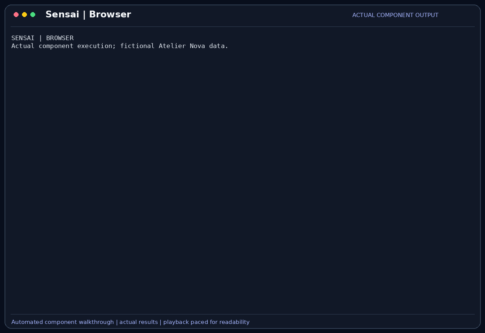

# Browser

Browser tools let Sensai interact with a web application: navigate, inspect page
content, fill fields, click controls and capture an image. They test behavior
rather than only downloading a page's text.

## Scenario

Camille checks a local cart preview before Malik reviews the module. She enters
prices 10 and 20, expects a subtotal of 30, then clears the field and expects 0.
She also enters invalid text to check that the page reports an error instead of
silently displaying a misleading total.

This feature belongs to the [Atelier Nova review scenario](../use-case.md#scenario-de-reference-camille-verifie-le-panier-datelier-nova). Camille uses the terminal and local Ollama between development tasks; the workflow allows time for inference rather than requiring an instant production response.

## User stories

### US-BROWSER-01 — Check the cart through its visible controls

**As Camille Moreau, the developer of the cart preview, I want Sensai to enter prices and calculate the subtotal through the page controls, so that I can verify the interaction a shopper would use.**

Preconditions: the preview is served over local HTTP, the browser is available, and click/type calls are approved when required.

| Acceptance criterion | Expected result |
| --- | --- |
| Navigation | The page title and accessible controls are returned after navigation. |
| Filled cart | Clicking Calculate subtotal for `10, 20` displays `Subtotal: 30`. |
| Empty cart | Clearing Item prices and calculating displays `Subtotal: 0`. |
| Evidence | The observation reflects the page after each action, rather than a predicted result. |

### US-BROWSER-02 — Check invalid input and prevent local-file navigation

**As Malik Benali, the reviewer of the cart preview, I want invalid input and unsupported navigation to be reported explicitly, so that a failed interaction is not mistaken for a successful functional test.**

Preconditions: the local preview is open and browser tools are enabled.

| Acceptance criterion | Expected result |
| --- | --- |
| Invalid prices | Entering `invalid` and calculating displays an explicit validation message. |
| Unknown target | An unresolvable element returns an error with current page context. |
| Ambiguity | Multiple controls with the same name require a disambiguating reference. |
| URL policy | A `file://` navigation request is rejected; only absolute HTTP(S) URLs are accepted. |

## How it works

| Tool | Role | Declared safe |
| --- | --- | --- |
| `browser_navigate` | Open an HTTP(S) URL and return page state. | Yes |
| `browser_snapshot` | Read the current accessibility tree. | Yes |
| `browser_click` | Click a control by name or reference. | No |
| `browser_type` | Fill a field and optionally submit it. | No |
| `browser_screenshot` | Return an image of the page; requires vision. | Yes |

The normal launcher opens visible Google Chrome through Playwright and retains one
shared page between calls. Page snapshots expose accessible names and references
such as `e7`. Actions resolve a reference or a control name and return the resulting
page state. Missing targets are reported with context so the next action can adapt.
Navigation has a 15-second timeout; actions have a 5-second timeout. Snapshots are
limited to 15,000 characters before ReAct applies its own observation limit.

## Demonstration



The capture uses the actual navigate, type, click and screenshot tools against the
local fictional cart page. It shows totals 30 and 0, a validation error for invalid
input, and rejection of a file URL. For this component recording, a real portable
headless Chromium page is supplied to the shared browser session; the normal
application launcher uses installed, visible Google Chrome. No model-selected
interaction or production login is claimed.

## Replay this demonstration

From the repository root, complete the [shared replay prerequisites](../demo_assets/demos/replay.md#shared-prerequisites).
The launcher opens the actual Sensai CLI with a temporary fictional profile and
working copies. Type the following commands and questions at `Vous >`; `/exit`
cleans up. Compare the stated facts and tool results, not identical model wording.

```bash
PLAYWRIGHT_BROWSERS_PATH=/tmp/sensai-demo-browsers PYTHONPATH=src .venv/bin/python docs/demo_assets/scripts/demos/replay.py browser
```

1. The launcher serves the fictional form at `http://127.0.0.1:18877/` and supplies
   the same portable Chromium session used by the component recording.
2. Send `Use browser_navigate to open http://127.0.0.1:18877/ and report the page title and controls.`
   Approve it if prompted. Expect the Atelier Nova cart page and **Item prices**.
3. Send `Use browser_click on Calculate subtotal and report the resulting page status.`
   Approve it. The initial `10, 20` input produces `Subtotal: 30`.
4. Send `Use browser_type on Item prices with an empty string. Do not submit yet.`
   Approve it, then repeat the click request. Expect `Subtotal: 0`.
5. Send `Use browser_type on Item prices with text invalid. Do not submit yet.`
   Approve it, then repeat the click request. Expect the invalid-prices message.
6. Send `Use browser_navigate with url file:///etc/passwd.` The URL is rejected;
   no file is read by that navigation request.

Use one interaction per message if the small model tries to combine or repeat
steps. This preserves the recorded form states and avoids exhausting a per-tool
budget. With the default text model, page state is textual; switching to a vision
model also permits a `browser_screenshot` request.

For the exact automated component sequence and a new GIF:

```bash
PLAYWRIGHT_BROWSERS_PATH=/tmp/sensai-demo-browsers PYTHONPATH=src .venv/bin/python docs/demo_assets/scripts/demos/record_features.py browser
PYTHONPATH=src .venv/bin/python docs/demo_assets/scripts/demos/render_features.py browser
```

## Architecture choices and tradeoffs

Accessibility snapshots are smaller than repeated screenshots and expose names the
model can use. Images remain useful for layout. The shared page preserves interaction
state but also couples subsequent calls to the same tab. Separate browser contexts
would isolate tasks better while adding lifecycle and state-management complexity.

## Limitations

The normal application needs Google Chrome and a display. Login state, inaccessible
controls, dynamic content and ambiguous names can make actions fail. Browser clicks
can submit forms or trigger external effects. The HTTP(S) policy blocks file URLs,
but does not provide a network-domain allowlist. The local fixture checks only its
cart form, not payment or a real shop.
