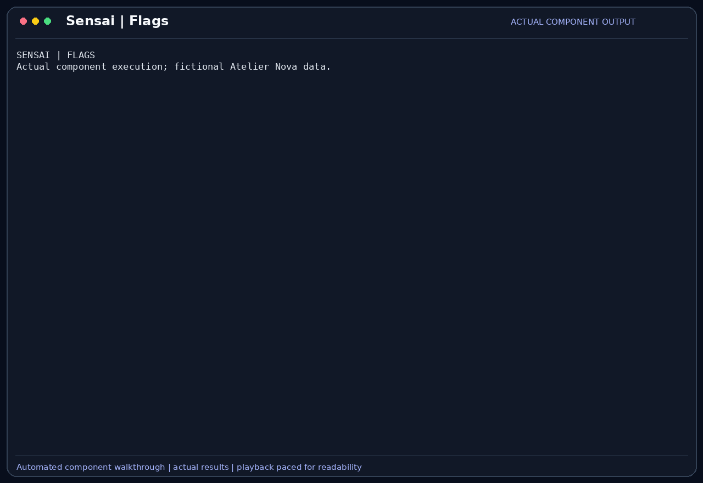

# Feature flags and settings

Feature flags control which components and individual tools participate in the
assistant's pipeline. They let the developer constrain a task or continue with
a smaller set of capabilities when one component is unnecessary.

## Scenario

Camille reviews private cart code and wants to prevent web lookup and unnecessary
host commands during a text-only question. She then needs to restore Bash for an
explicit test request. Malik wants restrictions to affect the actual available
tools, rather than merely asking the model not to use them.

This feature belongs to the [Atelier Nova review scenario](../use-case.md#scenario-de-reference-camille-verifie-le-panier-datelier-nova). Camille uses the terminal and local Ollama between development tasks; the workflow allows time for inference rather than requiring an instant production response.

## User stories

### US-FLAG-01 — Disable and restore a specific tool

**As Camille Moreau, the developer controlling the review environment, I want to disable and later re-enable host Bash execution, so that a text-only review does not offer an unnecessary command tool.**

Preconditions: the tool exists in the registry and Camille has an active profile.

| Acceptance criterion | Expected result |
| --- | --- |
| Disable | `/tools disable bash_tool` removes the tool from the available-tool list. |
| Other tools | Unrelated enabled tools retain their own availability rules. |
| Restore | `/tools enable bash_tool` makes it available again when the parent tools feature is enabled. |
| Persistence | The individual restriction is saved in the active profile settings. |

### US-FLAG-02 — Continue answering with tools disabled

**As Malik Benali, the reviewer requesting a conceptual explanation, I want the assistant to continue in text-only mode with tools disabled, so that a component restriction does not prevent ordinary discussion.**

Preconditions: the chat model is reachable and the `tools` feature is disabled.

| Acceptance criterion | Expected result |
| --- | --- |
| Availability | The agent has zero available execution tools. |
| Pipeline | A text request still produces a model response. |
| Honesty | That response does not claim to have executed tests. |
| Validation | Unknown feature names or tool names are reported rather than silently accepted as working restrictions. |

## How it works

Startup options include `--disable` for `tools`, `react`, `rag`, `compression`
and `mcp`, and `--disable-tool` for named tools. A shared feature-state object is
used by configuration, the agent and the UI.

Each tool belongs to a group: `web`, `browser`, `bash`, `files`, `sandbox`,
`screenshot`, and `mcp:<server>` for the tools of a connected MCP server. At runtime:

| Command | Effect |
| --- | --- |
| `/tools` | Opens a checkbox dialog with one entry per group (`browser (3/5 on)`). **Fine-tune…** then opens the tools of one group. **Cancel** or Esc changes nothing. |
| `/tools list` | Shows each tool with its group, source (built-in or MCP server), `safe` flag and status. The status says why a tool is off: `disabled`, `tools feature off` or `mcp feature off`. |
| `/tools enable\|disable <tool or group>...` | Changes several tools or whole groups at once, with Tab completion of names. Unknown names are reported. |

`/settings` → **Tools** opens the same dialog. Every confirmed change is saved to
the active profile right away.

Features (`tools`, `react`, `rag`, `compression`, `mcp`) are switched from
`/settings` → **Features**, a checkbox dialog with one entry per feature.
**Cancel** or Esc changes nothing.

Disabling `tools` removes all execution tools from availability. Disabling `mcp`
filters remote tools. Disabling `react` bypasses the orchestration loop and also
prevents tool execution through that loop. Disabling RAG or compression skips
the corresponding application stage. Trust, model selection and context-related
settings are distinct controls with their own scope.

## Demonstration



The actual tool command disables and restores `bash_tool`. The recording then
disables the parent tools feature and obtains a real English response from local
`llama3.2:latest` with zero available tools. This demonstrates continued text chat,
not a controlled quality comparison between feature-on and feature-off runs.

## Replay this demonstration

From the repository root, complete the [shared replay prerequisites](../demo_assets/demos/replay.md#shared-prerequisites).
The launcher opens the actual Sensai CLI with a temporary fictional profile and
working copies. Type the following commands and questions at `Vous >`; `/exit`
cleans up. Compare the stated facts and tool results, not identical model wording.

```bash
PYTHONPATH=src .venv/bin/python docs/demo_assets/scripts/demos/replay.py flags
```

1. Type `/tools disable bash_tool`, then `/tools list`. Expect host Bash to be shown
   as `off (disabled)` while unrelated tools retain their settings.
2. Type `/tools enable bash_tool`, then `/tools list`. Expect it to be on again.
3. Type `/settings`, choose **Features**, untick **tools**, choose **Ok**, then **Exit Menu**.
   `/tools list` now shows every tool as `off (tools feature off)`.
4. Send:

   ```text
   In one sentence, explain why an empty cart subtotal should be zero. Do not claim to have run tests.
   ```

5. Expect a real text response despite tools being disabled. It must not claim
   execution. This is the effect demonstrated by the GIF, beyond the settings change.
6. Re-enable **tools** with `/settings` → **Features** if continuing to another tool scenario.

The component replay changes the same shared feature state directly after using
the actual individual-tool commands. The interactive steps use the `/settings` → **Features** dialog;
neither path changes OS-level permissions.

For the exact automated component sequence and a new GIF:

```bash
PYTHONPATH=src .venv/bin/python docs/demo_assets/scripts/demos/record_features.py flags
PYTHONPATH=src .venv/bin/python docs/demo_assets/scripts/demos/render_features.py flags
```

## Architecture choices and tradeoffs

Shared flags make restrictions visible to the pipeline and support comparisons
without separate scripts. A whole-component flag is simple but can remove several
behaviors at once. More granular switches could isolate effects more precisely,
while increasing configuration complexity and combinations to validate.

## Limitations

Flags are not OS access controls. Disabling the built-in web tools does not block
network access through Bash, a browser or an MCP server. Disabling tools does not
make the selected chat endpoint local. Some model parameters and execution budgets
remain code constants. Disabling ReAct changes both orchestration and tool use,
so it does not isolate reasoning quality at equivalent tool access.
