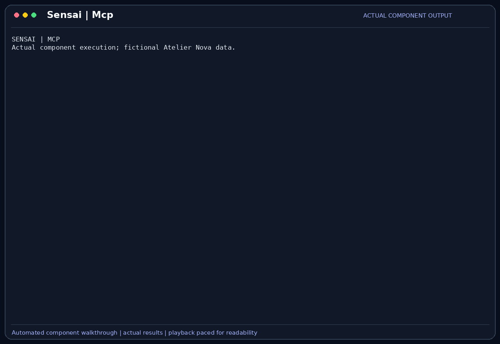

# MCP servers

MCP connections extend SensaiUwu with tools exposed by an HTTP server. The tools are
discovered during the conversation, adapted to SensaiUwu's tool interface and made
available to the same ReAct and approval pipeline as built-in tools.

## Scenario

Malik Benali maintains review requirements separately from Camille's code checkout.
For the demonstration, a local read-only MCP server exposes the cart rule
`CART-EMPTY-001`. Camille retrieves that rule without copying it manually into
every prompt, then compares it with the observed empty-cart result.

This feature belongs to the [Atelier Nova review scenario](../use-case.md#scenario-de-reference-camille-verifie-le-panier-datelier-nova). Camille uses the terminal and local Ollama between development tasks; the workflow allows time for inference rather than requiring an instant production response.

## User stories

### US-MCP-01 — Retrieve a review rule through a connected tool

**As Camille Moreau, the developer checking the cart requirements, I want SensaiUwu to discover a rule-reading tool from a configured MCP server, so that the review can refer to the requirement held by that service.**

Preconditions: the local demo server is running and MCP is enabled.

| Acceptance criterion | Expected result |
| --- | --- |
| Connection | `/mcp add-json atelier` accepts the HTTP configuration and discovers `cart_rule`. |
| Registration | The discovered tool becomes available to the agent with its declared argument schema. |
| Known rule | Calling `cart_rule` with `CART-EMPTY-001` returns the empty-cart subtotal rule of 0. |
| Unknown rule | A nonexistent identifier returns an explicit unavailable-rule response rather than an invented requirement. |

### US-MCP-02 — Keep connections and tool registration consistent

**As Malik Benali, the reviewer managing the demonstration environment, I want failed or closed MCP connections to leave tool registration consistent, so that the assistant does not offer disconnected or ambiguous tools.**

Preconditions: MCP tools are registered through the application connection manager.

| Acceptance criterion | Expected result |
| --- | --- |
| Validation | Malformed JSON or an unsupported URL is rejected before registration. |
| Names | Duplicate tool names conflicting with existing tools prevent the new registration. |
| Lifecycle | Connections remain open while their tools are in use. |
| Cleanup | Closing the manager removes its remote tools and closes its connections. |

## How it works

`/mcp add-json <name> '<json>'` accepts an HTTP(S) URL, optional headers and optional
OAuth settings. The connection manager opens the transport, discovers tools and
checks for name conflicts before retaining the connection. It keeps clients alive
with an asynchronous exit stack and removes registered remote tools on closure.

An adapter exposes the remote description and input schema to the agent and forwards
arguments to the server. JSON strings are decoded for schema fields expecting arrays
or objects. Remote tools default to `safe=False`, so normal approval rules apply.
[Detailed connection settings](../mcp-server.md) cover the supported authentication
and JSON configuration.

## Demonstration



Camille connects the read-only Atelier Nova rule server with `/mcp add-json`.
SensaiUwu discovers its tool, then the model selects that MCP tool to retrieve
`CART-EMPTY-001`. Camille sees the tool request and approves it. The bot uses the
returned requirement—an empty cart has subtotal `0`—to explain the expected test
value.

A second question requests an unknown payment rule. The same MCP tool returns
that no rule is available; the answer identifies the missing coverage instead of
inventing a payment requirement. These are actual HTTP MCP calls to a local fixture,
not a simulated external business service.

The capture uses the real interactive CLI, the local `llama3.2:latest` model and a
fictional preconfigured account. Only human messages and approval keystrokes are
automated. Idle waits are shortened for readability; the displayed application
output and generated answers are preserved.

## Replay this demonstration

Complete the [shared prerequisites](../demo_assets/demos/replay.md#shared-prerequisites),
then launch from the repository root:

```bash
PYTHONPATH=src .venv/bin/python docs/demo_assets/scripts/demos/replay.py mcp --model llama3.2:latest
```

At the `Vous >` prompt, submit the following messages in order. Inspect each
proposed tool call before answering `y` to its approval prompt.

1. The launcher starts the local fixture. Submit this slash command and check that one tool is discovered.

    ```text
    /mcp add-json atelier '{"url":"http://127.0.0.1:18876/mcp"}'
    ```

2. Approve the discovered MCP tool call. Expect `CART-EMPTY-001: An empty cart has subtotal 0.` in the answer, tied to an expected value of `0`.

    ```text
    Use the MCP tool cart_rule with rule_id=CART-EMPTY-001. Quote the returned rule and explain what value my empty-cart test should expect. Do not answer from memory.
    ```

3. Approve the second MCP call. Expect an unknown-rule response and no invented payment requirement.

    ```text
    Use cart_rule with rule_id=CART-PAYMENT-999. If the rule is unknown, say that payment is not covered by this source. Do not invent a rule.
    ```

Finish with `/exit` to close connections and remove the temporary workspace.
A fresh launch resets the scenario. Model wording and latency may vary; compare
the actual tool calls, returned values and errors.

To create a new capture and GIF of this same interactive scenario:

```bash
PYTHONPATH=src .venv/bin/python docs/demo_assets/scripts/demos/record_cli.py mcp
PYTHONPATH=src .venv/bin/python docs/demo_assets/scripts/demos/render_cli.py mcp
```

## Architecture choices and tradeoffs

MCP avoids writing a bespoke integration for every external service and preserves
its advertised schema. It adds transport, authentication and remote-service lifecycle
constraints. A built-in rule tool would be simpler for this one fixture, but would
not generalize to independent services as easily.

## Current limits

Authentication support depends on each server's OAuth registration behavior or a
valid configured credential. Discovery does not imply permission to perform every
remote action. Tools can expose sensitive data or side effects. The demo fixture
is local and read-only; it does not validate third-party availability or all
remote error conventions. CLI-provided configuration must not expose real secrets
in shared terminal recordings.
