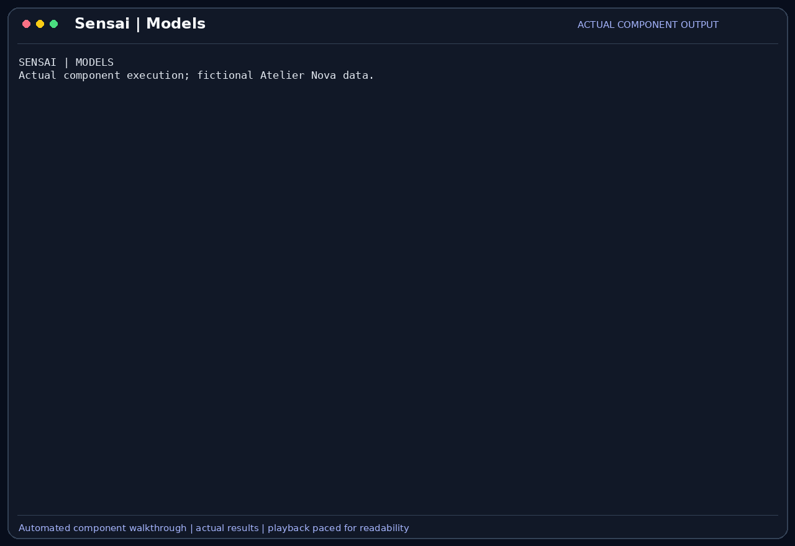

# Models and capabilities

SensaiUwu selects an Ollama model and checks its advertised capabilities before
offering tools that require them. This prevents a text-only model from receiving
a tool intended to produce an image it cannot interpret.

## Scenario

Camille uses a small model for the cart's textual test results. When she inspects
the preview visually, she needs a model with vision support. Malik wants that
choice to reflect an actual capability response rather than an assumption based
on the model's name.

This feature belongs to the [Atelier Nova review scenario](../use-case.md#scenario-de-reference-camille-verifie-le-panier-datelier-nova). Camille uses the terminal and local Ollama between development tasks; the workflow allows time for inference rather than requiring an instant production response.

## User stories

### US-MODEL-01 — Use a suitable model for text-based checks

**As Camille Moreau, the developer checking a small pytest suite locally, I want to select an available text model, so that the review can use the machine’s local inference resources without requiring visual analysis.**

Preconditions: the configured Ollama endpoint serves the selected model.

| Acceptance criterion | Expected result |
| --- | --- |
| Selection | `--model` sets the startup model; `/model` switches among the runtime allowlist. |
| Persistence | Runtime model selection is saved in the active profile settings. |
| Capability lookup | The client obtains capabilities from Ollama’s model information endpoint. |
| Unsupported name | An unknown runtime selection is reported without switching the current model. |

### US-MODEL-02 — Offer visual tools only to compatible models

**As Malik Benali, the reviewer checking the cart preview, I want image-producing tools offered only when the selected model supports vision, so that visual evidence is not sent to an incompatible model.**

Preconditions: screenshot tools are enabled and Ollama model information is reachable.

| Acceptance criterion | Expected result |
| --- | --- |
| Text model | `llama3.2:latest` does not receive `screenshot` or `browser_screenshot` when its capabilities omit vision. |
| Vision model | Switching to a model advertising vision makes enabled visual tools eligible. |
| Lookup error | A failed capability lookup yields no assumed capabilities. |
| Scope | Capability discovery is distinguished from measured answer quality or speed. |

## How it works

`--model` chooses the startup model. `/model` accepts the configured runtime
allowlist, currently `gemma4:e4b`, `qwen3.5:9b` and `llama3.2:latest`.
Selection changes do not download the model automatically.

The client calls Ollama's `/api/show` endpoint and caches capabilities per model.
The agent compares each tool's declared requirements with those capabilities.
`screenshot` and `browser_screenshot` require `vision`. Compatible image attachments
are passed separately from the textual observation. Generation parameters
(`--temperature`, `--top-p`, `--num-ctx` / `--context-length`) can be configured
via CLI flags or modified interactively via `/settings` and saved to profile settings.

## Demonstration



The recording obtains actual local Ollama capabilities, asks `llama3.2:latest`
a text question, switches to installed `qwen3.5:9b`, and asks the same question
again. Both selected models produce real answers. The eligible visual-tool list
changes from empty to `screenshot` and `browser_screenshot`; an unsupported runtime
name is rejected. Actual image interpretation appears in the separate Screenshot
recording. This is not a model-quality or resource benchmark.

## Replay this demonstration

From the repository root, complete the [shared replay prerequisites](../demo_assets/demos/replay.md#shared-prerequisites).
Prepare the temporary workspace shown in that guide, then run the example below
from that workspace. Complete the normal sign-in flow with a dedicated demo
profile. Type the listed messages at `Vous >`; compare observed tool results
rather than identical model wording.

```bash
"$SENSAI_DEMO_ROOT/.venv/bin/sensai" \
  --url http://127.0.0.1:11434/api/chat \
  --embed-url http://127.0.0.1:11434/api/chat \
  --token local-demo-placeholder --embed-token local-demo-placeholder \
  --model llama3.2:latest --num-ctx 8192 --trust none \
  --db-path "$SENSAI_DEMO_WORK" --personas-file personas.json \
  --disable tools rag compression mcp
```

1. The session starts on `llama3.2:latest`. Send:

   ```text
   Explain why a cart containing no items has subtotal zero. Answer in English in at most two short sentences, without running tools.
   ```

2. Inspect the real answer. Open `/tools`: with this text model, a screenshot is
   not usable by the model even if the tool is enabled in settings. The archived component capture shows the capability-filtered list directly.
3. Type `/model qwen3.5:9b`, then send the same question again. Inspect the second
   real answer; this uses the newly selected model rather than only changing a label.
4. Type `/model missing-demo-model`. Expect an explicit unknown-model message,
   with the current model unchanged.
5. For actual image interpretation, use the [Screenshot replay](Screenshot.md#replay-this-demonstration),
   which captures the isolated preview and asks the vision model to read its amounts.

The model must already be installed. Wording and speed differ across runs; this
scenario does not establish that one model is faster or more accurate. `/tools`
reports configured availability, not the full capability-filtered planning list.

## Architecture choices and tradeoffs

Capability filtering adapts tools to the selected model without duplicating the
agent. Smaller text models can suit simple checks, while vision models support
image evidence with different hardware costs. A fixed vision-only model would
simplify selection but impose its resource needs on every task. The
[benchmark report](../benchmark.md) separates model information from local measurements.

## Limitations

A capability flag does not guarantee correct tool choices or visual interpretation.
The runtime allowlist is narrower than Ollama's installed inventory. Stale cached
metadata or an unavailable endpoint can change tool eligibility. Planning temperature
is fixed at 0 in code to ensure deterministic JSON action selection, while final
answer generation uses user-configured temperature and top-p. Context size alone
does not prevent every truncation or loss.
