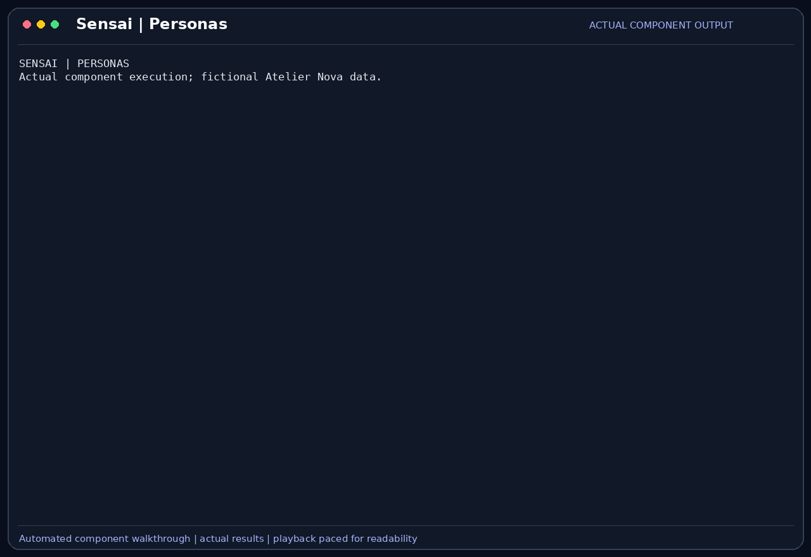

# Personas

A persona defines the assistant's role through a name, description and system
prompt. SensaiUwu loads personas from JSON and can switch the active system prompt
during a conversation without changing the model or tool implementation.

## Scenario

Camille uses an evidence-focused QA role while checking the cart. Malik then needs
a review perspective that separates covered behavior from assumptions. Both want
concise English answers appropriate to code review rather than a conversational
character whose style obscures the test result.

This feature belongs to the [Atelier Nova review scenario](../use-case.md#scenario-de-reference-camille-verifie-le-panier-datelier-nova). Camille uses the terminal and local Ollama between development tasks; the workflow allows time for inference rather than requiring an instant production response.

## User stories

### US-PERSONA-01 — Select a testing role suited to the review

**As Camille Moreau, the developer checking the cart regression, I want to choose an evidence-focused QA persona, so that the assistant organizes its explanation around observed outcomes rather than unsupported fixes.**

Preconditions: the demo persona JSON file contains a valid `qa` entry.

| Acceptance criterion | Expected result |
| --- | --- |
| Discovery | `/persona list` includes the configured QA role and its description. |
| Switch | `/persona switch qa` updates the active system prompt. |
| Role content | The prompt asks for observed outcomes, evidence and limitations, and approval before code changes. |
| Scope | Changing the persona does not change tool permissions or authorize an action. |

### US-PERSONA-02 — Change review perspective without losing the active role on error

**As Malik Benali, the developer reviewing Camille’s test evidence, I want to select a review persona and receive an explicit error for unknown roles, so that I know which instructions guide the assistant.**

Preconditions: a valid `reviewer` entry exists and a different role can already be active.

| Acceptance criterion | Expected result |
| --- | --- |
| Review role | Switching to `reviewer` replaces the active prompt with the review instructions. |
| Missing role | An unknown persona name produces a warning. |
| State | An unsuccessful switch leaves the existing prompt unchanged. |
| Invalid configuration | A missing file or required field is reported as a loading error. |

## How it works

Each entry in `personas.json` requires `name`, `description` and `system_prompt`.
`--persona` selects a role at startup, while `/persona list` and
`/persona switch <key>` inspect or change roles at runtime. Runtime switching
updates the agent's system prompt; it does not instantiate another agent.

The feature-tour fixture supplies `qa` and `reviewer` personas. The repository's
normal persona file also contains general and character roles; those should not
be confused with the dedicated QA configuration shown here.

## Demonstration



The recording loads the two fixture personas and sends the same review message
through the real application chat path after each switch. The QA answer begins
with `QA CHECK`; the reviewer answer begins with `REVIEW NOTE` and adopts the
review perspective. Both answers are generated by local `llama3.2:latest`.
An unknown key leaves the reviewer prompt unchanged. The generated headings do
not match every formatting instruction exactly; this demonstrates role-conditioned
responses, not guaranteed instruction compliance.

## Replay this demonstration

From the repository root, complete the [shared replay prerequisites](../demo_assets/demos/replay.md#shared-prerequisites).
Prepare the temporary workspace shown in that guide, then run the example below
from that workspace. Complete the normal sign-in flow with a dedicated demo
profile. Type the listed messages at `Vous >`; compare observed tool results
rather than identical model wording.

```bash
"$SENSAI_DEMO_ROOT/.venv/bin/sensai" \
  --url http://127.0.0.1:11434/api/chat \
  --embed-url http://127.0.0.1:11434/api/chat \
  --token local-demo-placeholder --embed-token local-demo-placeholder \
  --model llama3.2:latest --num-ctx 8192 --trust none \
  --db-path "$SENSAI_DEMO_WORK" --personas-file personas.json \
  --disable tools rag compression mcp
```

1. The example loads the QA/reviewer personas copied into the temporary workspace.
   List and select the first role:

   ```text
   /persona list
   /persona switch qa
   ```

2. Send the message used in the GIF:

   ```text
   I observed one passing test and one failing test: test_empty_basket returns 1 instead of 0. I have not checked payment. Summarize this for my review; do not run tools.
   ```

3. Expect an actual role-conditioned reply beginning with `QA CHECK`, organized
   around the result and its evidence or limits. The test result here is supplied
   by the developer; the persona is not claiming to have run tests.
4. Type `/persona switch reviewer`, then send the exact same message again.
   Expect a reply beginning with `REVIEW NOTE`, using a review decision, risk and
   follow-up question. The changed response is visible, not only the changed prompt.
5. Type `/persona switch missing`. Expect a warning; the reviewer role remains
   active. Sending the message again can confirm the role still applies.

The recorded model used the expected role prefixes but did not follow every requested
heading exactly. Role behavior and factual accuracy remain observable criteria,
not guarantees made by setting a system prompt.

## Architecture choices and tradeoffs

JSON keeps role instructions editable without Python changes. One agent with a
switchable role is lighter than multi-agent orchestration, but does not provide
independent reviewers or isolated reasoning. Separate agents would require
coordination and additional inference calls.

## Limitations

A persona changes instructions, not model weights or capability support. It cannot
guarantee factual answers, command safety or a specific reporting format. The
standard file path is fixed by configuration code, and malformed JSON can prevent
loading. Runtime role selection is not automatically a persisted persona preference.
