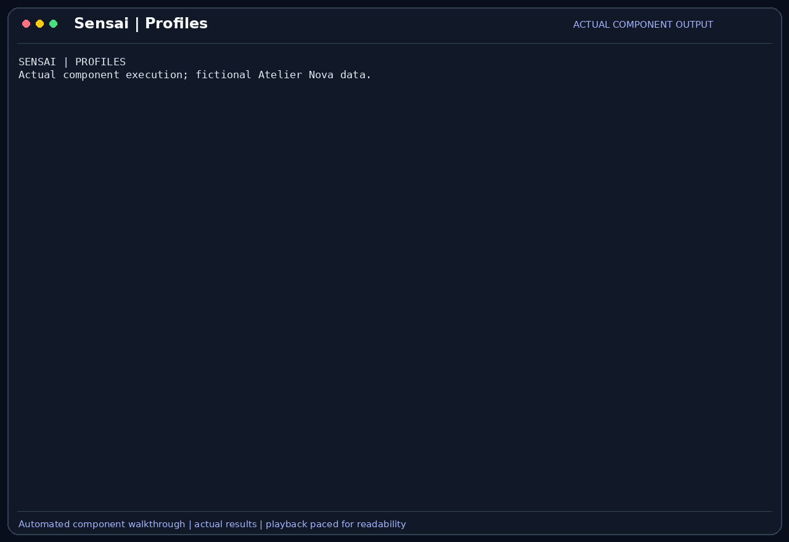

# Profiles, preferences and instructions

Profiles store a developer's preferences, instructions and settings alongside
sessions and messages in SQLite. Preferences and instructions are added to each
new conversation request for the active profile.

## Scenario

Camille prefers concise English summaries and pytest's quiet output. She also wants
the assistant to leave payment code untouched during the cart review. Malik has a
separate review role and should not inherit her private settings merely because
he is discussing a similar module.

This feature belongs to the [Atelier Nova review scenario](../use-case.md#scenario-de-reference-camille-verifie-le-panier-datelier-nova). Camille uses the terminal and local Ollama between development tasks; the workflow allows time for inference rather than requiring an instant production response.

## User stories

### US-PROFILE-01 — Reuse the developer’s testing conventions

**As Camille Moreau, the developer repeatedly checking the cart, I want to save my test conventions and scope instructions, so that I do not have to restate them before every question.**

Preconditions: Camille is authenticated to her profile and a session belongs to that profile.

| Acceptance criterion | Expected result |
| --- | --- |
| Preferences | `/prefs add` stores a concise-English and pytest preference. |
| Instructions | `/inst add` stores the request not to edit payment code. |
| Context | Both appear in the system context of a newly built request. |
| Editing | List, edit and remove operations use explicit indices and reject invalid ones. |

### US-PROFILE-02 — Recover profile settings after authentication

**As Camille Moreau, the developer returning to the cart review, I want my saved profile settings available after logging in again, so that the assistant continues using my working conventions.**

Preconditions: a profile exists in the local database and its password is supplied.

| Acceptance criterion | Expected result |
| --- | --- |
| Authentication | The correct password authenticates the fictional profile. |
| Persistence | The saved preferences and instructions are available after reauthentication. |
| Wrong password | A wrong password does not authenticate the profile. |
| Isolation | Profile context is injected only when the active profile owns the session. |

## How it works

`/prefs` and `/inst` support `list`, `add`, `edit` and `remove`. Their current
values are loaded into a system message before conversation history when the
active profile matches the session owner. Profile settings also retain selected
model, trust level and tool restrictions where supported by their commands.

Passwords are verified against salted password hashes using the configured hashing
parameters. Sessions, messages and document data are stored locally in SQLite.
The application has separate credential-state/keyring handling, which is not the
same as encryption of the database contents.

## Demonstration



The recording saves preferences and instructions in a temporary fictional profile,
then sends a question through the application's real chat path. The answer uses
`pytest -q` and identifies payment as the module to leave untouched, showing that
the stored context affects the reply. The capture then reauthenticates the demo
profile and rejects a wrong password. It does not access a real account keyring
or record the interactive account wizard.

## Replay this demonstration

From the repository root, complete the [shared replay prerequisites](../demo_assets/demos/replay.md#shared-prerequisites).
The launcher opens the actual Sensai CLI with a temporary fictional profile and
working copies. Type the following commands and questions at `Vous >`; `/exit`
cleans up. Compare the stated facts and tool results, not identical model wording.

```bash
PYTHONPATH=src .venv/bin/python docs/demo_assets/scripts/demos/replay.py profiles
```

1. In the fresh fictional Camille profile, type:

```text
/prefs add Use concise English summaries and pytest -q.
/inst add Do not edit payment code.
/prefs list
/inst list
```

2. Each slash command is submitted separately. Confirm that the saved preference
   and instruction appear, then send:

```text
Which test command should I use and which module must I leave untouched? Answer using my saved preferences and instructions, not an assumed convention.
```

3. Expect a real response referring to `pytest -q` and the payment module. Those
   facts were supplied through the profile, not through this question.
4. To inspect modification behavior, use `/prefs edit 0 ...` or `/inst remove 0`
   and list the values again. Only this disposable profile is affected.

The regenerated GIF shows the stored context being used in a reply, followed by
component-level logout/login and rejection of a wrong password. For that exact
password-check sequence, use the component replay below. The interactive launcher
starts a preauthenticated demo profile and does not change your real keyring.

For the exact automated component sequence and a new GIF:

```bash
PYTHONPATH=src .venv/bin/python docs/demo_assets/scripts/demos/record_features.py profiles
PYTHONPATH=src .venv/bin/python docs/demo_assets/scripts/demos/render_features.py profiles
```

## Architecture choices and tradeoffs

SQLite keeps related profile and session data in one queryable local store.
Explicit preference commands make the saved text inspectable, while model-inferred
preferences would be less predictable. A JSON-file alternative would be simpler
for one profile, but would need separate consistency and relationship management.

## Limitations

Instructions are prompt guidance, not filesystem access controls. SQLite content
is not automatically encrypted. Credential-state and keyring errors can affect
login convenience separately from database persistence. Each launch starts a new
session; earlier ones are reopened with [`/session`](Sessions.md), but nothing is
recalled across sessions.
