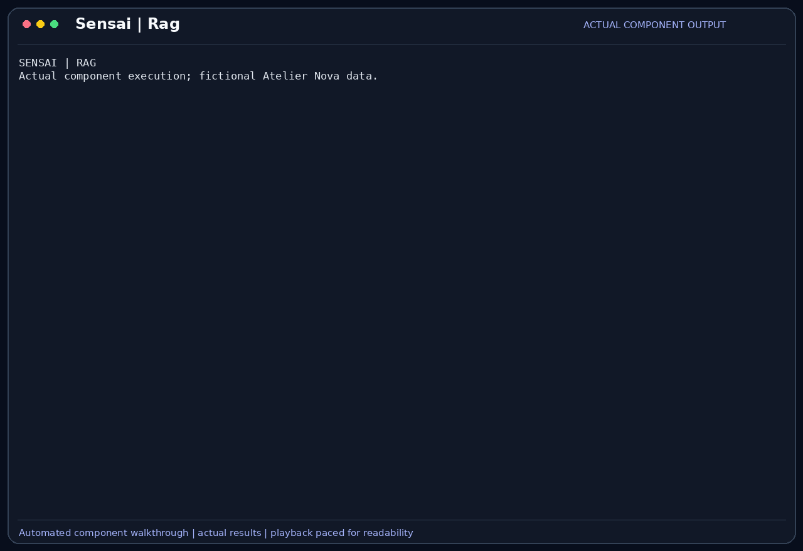

# RAG on documents

Retrieval-augmented generation adds relevant excerpts from attached documents to
the model's context. Sensai converts documents to text, chunks and embeds them,
then combines semantic and keyword search within the current session's documents.

## Scenario

Camille wants to compare the cart implementation with Atelier Nova's written rule,
not the model's general assumptions about shopping carts. She attaches the fictional
cart specification containing `CART-EMPTY-001`: an empty cart has subtotal 0 and no
handling fee is added by that function. Malik needs to see which document supports
that expectation.

This feature belongs to the [Atelier Nova review scenario](../use-case.md#scenario-de-reference-camille-verifie-le-panier-datelier-nova). Camille uses the terminal and local Ollama between development tasks; the workflow allows time for inference rather than requiring an instant production response.

## User stories

### US-RAG-01 — Retrieve the requirement relevant to a failing test

**As Camille Moreau, the developer investigating the empty-cart failure, I want Sensai to retrieve the matching part of the attached cart specification, so that the diagnosis uses the project requirement rather than an assumed rule.**

Preconditions: RAG is enabled, the specification is attached and the embedding model is available.

| Acceptance criterion | Expected result |
| --- | --- |
| Ingestion | The document is converted, embedded and stored with its chunks. |
| Retrieval | An empty-cart query retrieves an excerpt containing `CART-EMPTY-001`, subtotal 0 and marker `NOVA-QA-4827`. |
| Context | The excerpt is labeled with its document and excerpt identifiers before the newest user request. |
| Scope | The answer distinguishes the subtotal requirement from untested payment behavior. |

### US-RAG-02 — Keep one review separate from another

**As Malik Benali, the reviewer handling separate project sessions, I want retrieval limited to documents attached to the active session, so that a requirement from another review is not silently used as evidence.**

Preconditions: one session has the cart specification and another has no attached documents.

| Acceptance criterion | Expected result |
| --- | --- |
| Session scope | The populated session can retrieve its own document chunks. |
| Empty session | The session without documents returns no retrieved chunks. |
| No invented evidence | No-document retrieval does not create an excerpt or document citation. |
| Unsupported input | An unreadable or unsupported document is not presented as successfully extracted content. |

## How it works

Documents from `--files` or paths returned by file tools are converted to Markdown
with MarkItDown. The default chunk size is 1,500 characters, with 200 characters
overlap. `nomic-embed-text` produces embeddings through Ollama; the index expects
768 dimensions. Nomic queries and documents use their respective search prefixes.

Chunks are stored with vector search in sqlite-vec and keyword search in SQLite
FTS5. The rankings are merged with reciprocal rank fusion. Retrieval returns up
to three chunks by default, restricted to documents attached to the current session.
The excerpt block follows summary/history context and precedes the latest request.
Ingestion embeds before writing the document and chunks in one transaction.

## Demonstration



The recording ingests the specification with actual local `nomic-embed-text`
embeddings and asks a question through the application's retrieval, chat and storage
path. The actual answer gives subtotal 0, rule `CART-EMPTY-001`, marker
`NOVA-QA-4827` and a document/excerpt reference. Neither identifier is supplied in
the question: the marker provides a visible connection to the attached document.

A second session has no document and retrieves zero chunks. The same question
then produces an invented section reference from the small model instead of a
clean refusal. This negative response fails the no-invented-evidence criterion;
session-scoped retrieval itself still returns nothing. The short specification
fits in one chunk, so the capture is not a retrieval-quality benchmark.

## Replay this demonstration

From the repository root, complete the [shared replay prerequisites](../demo_assets/demos/replay.md#shared-prerequisites).
The launcher opens the actual Sensai CLI with a temporary fictional profile and
working copies. Type the following commands and questions at `Vous >`; `/exit`
cleans up. Compare the stated facts and tool results, not identical model wording.

```bash
PYTHONPATH=src .venv/bin/python docs/demo_assets/scripts/demos/replay.py rag
```

1. The launcher attaches `cart-spec.md` and embeds it locally with
   `nomic-embed-text` before the chat prompt appears. Tools are disabled so the
   answer must use conversation/document context rather than a file or web lookup.
2. Send this exact question; it deliberately does not supply the rule or marker:

```text
According to the attached specification, what is the empty-cart subtotal, which rule and review marker support it, and does this cover payment? Cite the excerpt.
```

3. Expect a real answer containing subtotal `0`, rule `CART-EMPTY-001`, marker
   `NOVA-QA-4827`, and a reference to the retrieved document/excerpt. Payment is
   outside the specified module's scope. The unique marker comes from the document.
4. Exit, then start a fresh document-free session:

```bash
PYTHONPATH=src .venv/bin/python docs/demo_assets/scripts/demos/replay.py rag --without-document
```

5. Ask the same question. Retrieval returns no chunks. The required answer is an
   explicit lack of document evidence; the recorded small-model response instead
   invented a section reference. That is an observed failure, not an expected
   successful citation. Never treat its fabricated heading as a retrieved excerpt.

The regenerated GIF includes both actual model replies. It demonstrates document-
based answering in the first session and the remaining refusal/grounding weakness
in the second. Another run can produce different wording or failure behavior.

For the exact automated component sequence and a new GIF:

```bash
PYTHONPATH=src .venv/bin/python docs/demo_assets/scripts/demos/record_features.py rag
PYTHONPATH=src .venv/bin/python docs/demo_assets/scripts/demos/render_features.py rag
```

## Architecture choices and tradeoffs

Hybrid search supports both meaning and exact identifiers such as a test or rule
name. It adds embedding and indexing costs but avoids sending every document in
full on every turn. A keyword-only alternative would avoid embedding inference
while being less robust to paraphrased questions.

## Limitations

The embedding model must be available and compatible with the fixed vector size.
Scanned documents without extractable text may fail; unsupported formats and empty
content need explicit handling. The startup ingestion path currently can print a
success message after catching an extraction failure, so that message alone does
not prove ingestion. Top-ranked chunks are not proof of correctness or complete
coverage, and unrelated queries can still retrieve weakly relevant excerpts.
Attached documents may contain untrusted instructions or private data.
