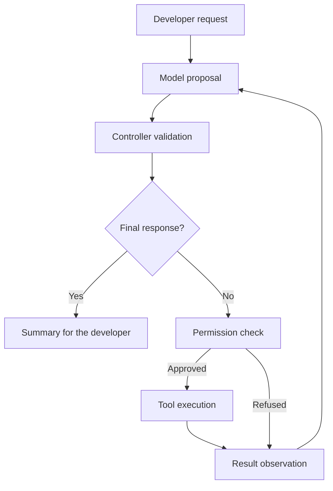

# ReAct loop — A1

The **ReAct** loop lets SensaiUwu alternate between decisions, actions and observations
before replying to the developer. It turns a testing request into a sequence of
actions, with each step taking the previous result into account.

## Scenario: Camille prepares the cart module for review

Camille Moreau, a Python developer at Atelier Nova, is preparing a merge request
for the cart calculation module. Her colleague Malik Benali needs to distinguish
actual test results from an explanation of the code. Camille works in the terminal
with SensaiUwu and a local Ollama model, using fictional data.

In the [reference scenario](../use-case.md#scenario-de-reference-camille-verifie-le-panier-datelier-nova),
she encounters two situations: a version that returns 1 for an empty cart, then a
correct version that returns 0. These are independent demo projects; switching to
the correct version does not imply that SensaiUwu modified the code. In both cases,
she expects an accurate test summary before proceeding with the review.

This check takes place between development tasks. She can wait for local inference;
the task does not require an instant response. The terminal, approval prompts and
a short summary in French fit her working environment.

## Value for the testing assistant

A diagnosis depends on what actually happens in the project: a build result, an
error message, file contents or application behavior. The loop lets the model
retrieve this information through the available tools, then adapt its next action.

For example, when asked “Why are the tests failing?”, SensaiUwu can run the tests,
observe the error and produce a summary based on that output. In a longer workflow,
the same mechanism can combine execution, file inspection and another check.

## User stories

### US-A1-01 — Understand a regression before review

**As Camille Moreau, the developer of the cart module, I want SensaiUwu to run the
tests and identify the failing check, so that I can focus my investigation on
the behavior blocking the code review.**

Preconditions: the faulty version is accessible from the repository root, ReAct
and `bash_tool` are enabled, and Camille approves the test command.

| Acceptance criterion | Expected result |
| --- | --- |
| Execution | The command targets `docs/demo_assets/examples/demos/python-tests` and runs in the foreground. |
| Use of the result | The summary reports one passing test and one failing test, consistent with exit code `1`. |
| Diagnosis | `test_empty_basket` is identified; the observed amount is 1 and the expected amount is 0. |
| Scope | SensaiUwu does not claim to have fixed the code or report that the suite passed. |
| Completion | A final response is produced without indefinitely rerunning the same command. |

### US-A1-02 — Confirm the covered behavior before submitting the code

**As Camille Moreau, a developer preparing her merge request, I want SensaiUwu to
check the correct version of the cart module, so that I can give Malik a summary
of the checks that actually passed before his review.**

Preconditions: the correct version is used, ReAct and `bash_tool` are enabled,
and Camille approves the test command.

| Acceptance criterion | Expected result |
| --- | --- |
| Execution | The command targets `docs/demo_assets/examples/demos/python-tests-passing` and runs in the foreground. |
| Use of the result | The summary reports two passing tests and no failing tests, consistent with exit code `0`. |
| Covered behavior | The checks cover a non-empty cart totaling 30 and an empty cart totaling 0. |
| Scope | SensaiUwu does not claim that these two tests validate payments, security or the entire store. |
| Integrity | The check modifies neither the module nor the tests. |

Both stories belong to the same scenario: deciding whether the local module checks
allow the review to proceed. They define acceptance criteria; the GIF below
illustrates US-A1-01.

## How it works

At each step, the model proposes a decision structured into three fields:

| Field | Role |
| --- | --- |
| `thought` | Justification for the proposed step. |
| `action` | Tool to call, or decision to proceed to the final response. |
| `args` | Arguments required by the action. |

The controller validates the action and its arguments before execution.
Authorization then depends on the permissions and trust level chosen by the
developer. The result, error or refusal becomes an observation passed to the
model for the next step.



The loop is integrated into SensaiUwu's main pipeline. Model calls go directly to
the Ollama HTTP API, without an intermediate LLM framework. The model proposes
actions; Python code controls their validation and execution.

## Context construction

The model receives the conversation context prepared by the agent and the
planning instructions. For the current request, previous steps are appended in
execution order: proposal, observation, then the next proposal. The latest
observation is therefore the most recent result the model can use.

A JSON schema specifies the decision format and the actions still available.
If the server does not follow this schema, an explicit text instruction states
the expected format. When the loop ends, a separate call produces the final
response from the information gathered.

## Execution control

The controller rejects unknown tools, missing or incorrectly typed required
arguments, and identical calls repeated without permission. Some monitoring
tools may repeat a call when its result changes over time.

| Default limit | Value |
| --- | --- |
| Planning steps per message | 10 |
| Successful tool calls in total | 10 |
| Successful calls per tool | 2 |
| Content retained per observation | 6,000 characters |

A shortened observation includes a truncation marker. Budgets bound execution
to prevent a model from continuing the same investigation indefinitely. These
values are defined in code; they are not all available in user configuration.

The feature can be disabled with `--disable react`. In this mode, the model
replies directly, bypassing the tool execution loop.

## Demonstration: identify a failing test

Camille checks the calculation of a cart total. The demo project contains two
tests and an intentional defect: an empty cart returns **1 instead of 0**.


[Watch the video demonstration](../demo_assets/assets/demos/python-tests.mp4)

Camille asks SensaiUwu to run the tests in the foreground and summarize the result.
The model proposes a call to `bash_tool`. After approval, pytest runs and its
result feeds into the final response.

| Step | Observed result |
| --- | --- |
| Action | Actual test execution through `bash_tool`. |
| Authorization | The user approves the command. |
| Observation | One passing test, one failing test; exit code `1`. |
| Summary | Identification of `test_empty_basket` and the failed comparison `1 == 0`. |
| Completion | Final response after using the tool result. |

The defect belongs to the demo project. This demonstration covers execution and
result reporting; it does not include a code fix. It was recorded with
**llama3.2:latest on local Ollama 0.34.2**. The GIF replays a terminal session
at its original speed, with a preconfigured demo profile and automated input.

### Two test situations

| Demo project | Empty-cart behavior | Reference result |
| --- | --- | --- |
| [Faulty version](../demo_assets/demos/python-tests.md) — US-A1-01 | Returns 1 instead of 0. | `1 failed, 1 passed`; exit code `1`. |
| [Correct version](../demo_assets/demos/python-tests-passing.md) — US-A1-02 | Returns 0. | `2 passed`; exit code `0`. |

Both projects retain the same business checks. The GIF shows the first situation;
the second has its own executable demo project.

## Replay this demonstration

From the repository root, complete the [shared replay prerequisites](../demo_assets/demos/replay.md#shared-prerequisites).
The launcher opens the actual SensaiUwu CLI with a temporary fictional profile and
working copies. Type the following commands and questions at `Vous >`; `/exit`
cleans up. Compare the stated facts and tool results, not identical model wording.

```bash
PYTHONPATH=src .venv/bin/python docs/demo_assets/scripts/demos/replay.py react
```

1. Launch the session above. Leave **Tool Trust Level** at `none`.
2. Send this request:

   ```text
   Execute this exact command in the foreground with bash_tool (background=false), then report the actual result without changing files: .venv/bin/python -m pytest -c cart-failing/pytest.ini --no-cov -q cart-failing
   ```

3. Check the proposed command and answer `y` at `Approve this action? [Y/n]`.
4. The observation must contain exit code `1`, `1 failed, 1 passed`, and
   `test_empty_basket` with actual 1 versus expected 0. The final answer should use
   those facts; it must not claim a correction.
5. For the passing counterpart, send the same request with `cart-passing` in place
   of both occurrences of `cart-failing`, then approve it. Expect exit code `0`
   and `2 passed`.

The first request reproduces the failing-suite workflow in the GIF. The second
shows a genuinely passing suite in the same application. The launcher changes
only the fixture location to a disposable workspace.

## Architecture choices and tradeoffs

An iterative loop selects the next investigation based on the previous result.
This flexibility suits an assistant that handles different errors across projects.
However, it requires additional model calls and increases response time on local
hardware. Budgets limit this cost, but can also stop an investigation that would
need more steps.

An alternative would be a deterministic workflow: run a test command chosen by
the developer, then ask the model for a single summary of its output. This would
be more predictable and require fewer calls, but would not let the model freely
select a new investigation. ReAct prioritizes that ability to adapt.

Permissions govern proposed actions and make sensitive commands visible before
execution. The loop does not replace tool isolation: a command running on the
host retains its effects on accessible files and services. Observations may also
contain project data, whose confidentiality depends on the model provider and
how that data is retained.

## Observed limitations

Validating an action does not guarantee an accurate final response. In one trial,
a background command was refused, after which the model described tests that had
not been executed. This shows that a response can remain incorrect even when
unauthorized execution is prevented.

The demonstration presents a successful workflow; it does not measure the success
rate or a performance improvement. The `thought` field remains a generated
justification, and truncated observations may lose details useful for diagnosis.
