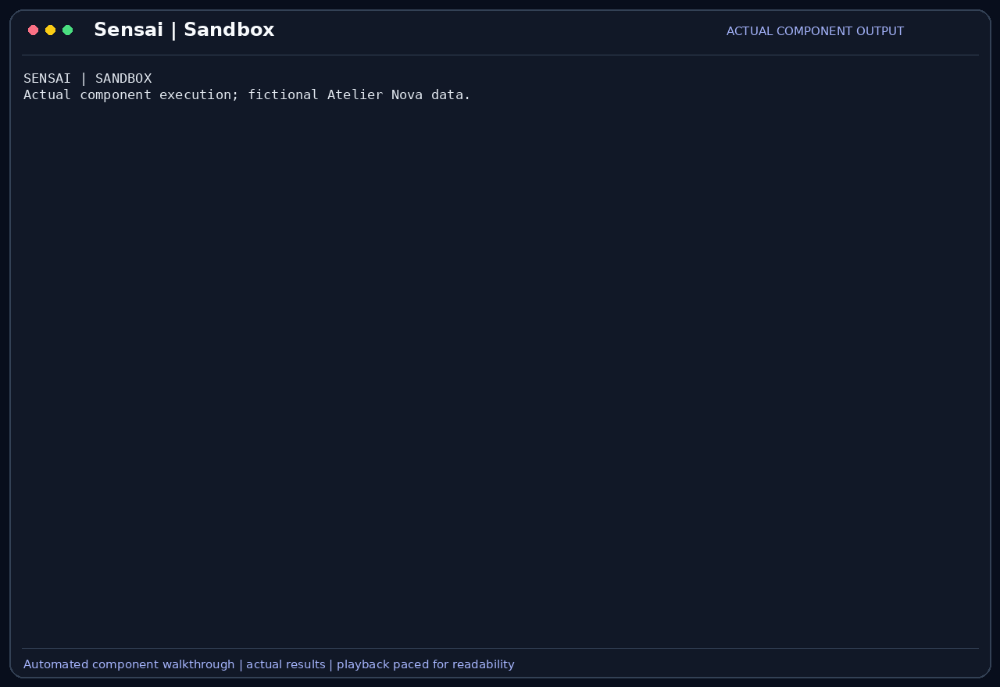

# Sandboxed code

`sandboxed_code` executes Python or Bash in a disposable Docker container, with
resource limits and restricted access. It provides a separate environment for
small generated checks rather than running them directly on the host.

## Scenario

Camille wants to check the cart subtotal on empty and non-empty inputs using a
small Python reference function. She wants the experiment separated from her
working tree and an assertion failure reported as a failure. The source under test
must be supplied explicitly; the container does not mount her project.

This feature belongs to the [Atelier Nova review scenario](../use-case.md#scenario-de-reference-camille-verifie-le-panier-datelier-nova). Camille uses the terminal and local Ollama between development tasks; the workflow allows time for inference rather than requiring an instant production response.

## User stories

### US-SANDBOX-01 — Run a disposable reference check

**As Camille Moreau, the developer investigating cart behavior, I want to execute a small Python reference check outside my working tree, so that the experiment does not modify project files.**

Preconditions: Docker is available, the sandbox image can be built and the call is approved when required.

| Acceptance criterion | Expected result |
| --- | --- |
| Input | Raw Python source is provided with `language=python`, preserving indentation. |
| Checks | The supplied reference checks for `[10, 20]` and `[]` pass and print an explicit result. |
| Identity | The container runs as the unprivileged user configured in its image. |
| Isolation | No host project directory or Docker socket is mounted into the code container. |

### US-SANDBOX-02 — Keep failing experiments visible and clean them up

**As Malik Benali, the reviewer assessing generated experiments, I want a failing assertion to be reported and its container removed, so that a failed check does not become a false success or leave a running worker.**

Preconditions: a sandbox call supplies `assert 1 == 0` or another known failing check.

| Acceptance criterion | Expected result |
| --- | --- |
| Failure | A nonzero container exit produces an execution error with bounded output. |
| Cleanup | Container removal runs in `finally`, including failure and wait-error paths. |
| Timeout | The client waits at most 20 seconds for execution before cleanup is attempted. |
| No invented result | A failed experiment is not described as a passed test. |

## How it works

The tool takes `language` (`python` or `bash`) and raw `code`. It builds the
corresponding image and runs it in a worker thread, keeping the asynchronous
interface available.

| Restriction | Configured value |
| --- | --- |
| CPU allocation | Half a core |
| Memory | 512 MB |
| Process count | 64 |
| Network | Disabled for the code container |
| Root filesystem | Read-only |
| Privileges | Capabilities dropped; no new privileges; non-root image user |
| Writable workspace | Temporary `/workspace` and `/tmp` mounts |
| Wait | 20 seconds, followed by cleanup on exit or error |
| Returned output | Up to 64 KiB |

The Python image uses isolated interpreter mode. The tool returns the execution
output; a failed container exit raises an error which the agent can turn into an
observation. Normal host builds and test suites use [Bash](Bash.md), not a project
mount inside this sandbox.

## Demonstration



The actual Docker runner executes two successful cart checks as UID 10001, then
runs a deliberate failing assertion. Both calls use the Python sandbox. The
failure remains visible in the component output; this is not a recording of the
model generating the source or a proof of every security boundary.

## Replay this demonstration

From the repository root, complete the [shared replay prerequisites](../demo_assets/demos/replay.md#shared-prerequisites).
The launcher opens the actual Sensai CLI with a temporary fictional profile and
working copies. Type the following commands and questions at `Vous >`; `/exit`
cleans up. Compare the stated facts and tool results, not identical model wording.

```bash
PYTHONPATH=src .venv/bin/python docs/demo_assets/scripts/demos/replay.py sandbox
```

1. Check that Docker is running, then send this request:

```text
Use sandboxed_code with language=python and code="assert sum([10, 20]) == 30; assert sum([]) == 0; print('2 cart checks passed')". Do not run it on the host.
```

2. Inspect and approve the sandbox call. Expect `2 cart checks passed`.
3. Send:

```text
Use sandboxed_code with language=python and code="assert 1 == 0, 'empty cart regression'". Do not use host Bash.
```

4. Approve the call with the supplied Python assertion.
   Expect an assertion error, not a successful check. The container is removed
   by the runner's cleanup path.

The GIF uses an equivalent reference function and additionally prints UID 10001.
The supplied code is a standalone experiment; it does not import the host project.
The exact component replay below uses the full recorded Python source.

For the exact automated component sequence and a new GIF:

```bash
PYTHONPATH=src .venv/bin/python docs/demo_assets/scripts/demos/record_features.py sandbox
PYTHONPATH=src .venv/bin/python docs/demo_assets/scripts/demos/render_features.py sandbox
```

## Architecture choices and tradeoffs

Disposable containers give experiments a separate filesystem and process boundary,
with limits more explicit than direct host execution. Image builds and startup add
latency. A persistent restricted worker could reduce startup cost, but would need
stronger state-reset and cross-request isolation controls.

## Limitations

Docker availability and image builds are prerequisites; builds may require network
access even though the code container has networking disabled. The 20-second wait
is a client-side wait, with forced removal in cleanup; image build time is outside
that limit. The container cannot automatically test host code it cannot access.
Container isolation reduces exposure but does not prove immunity to daemon or
kernel vulnerabilities. Returned output limits do not replace all runtime quotas.
