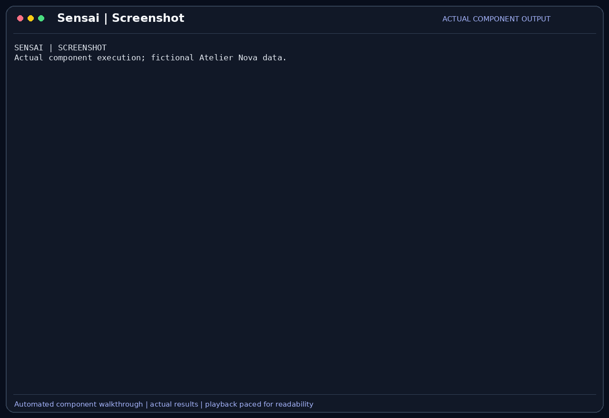

# Screenshot

The `screenshot` tool captures the current display and attaches an image to the
model's observation. It supports checks whose result is visual, such as whether
a preview window opened and which values or error messages it displays.

## Scenario

Camille opens a cart preview while preparing the review. A successful process exit
or a clean terminal does not tell Malik whether the visible cart shows the expected
amount. She wants an image of that state, with fictional cart data, and an assistant
that only attempts visual interpretation when its model supports images.

This feature belongs to the [Atelier Nova review scenario](../use-case.md#scenario-de-reference-camille-verifie-le-panier-datelier-nova). Camille uses the terminal and local Ollama between development tasks; the workflow allows time for inference rather than requiring an instant production response.

## User stories

### US-SCREEN-01 — Inspect the visible cart preview

**As Camille Moreau, the developer checking the cart preview, I want Sensai to capture the visible window, so that I can compare the displayed subtotal with the test expectation.**

Preconditions: a display is available, a vision-capable model is selected and the screenshot call is approved when required.

| Acceptance criterion | Expected result |
| --- | --- |
| Capture | The tool returns a JPEG image from the current display. |
| Dimensions | The image fits within 1920 by 1080 pixels while preserving its aspect ratio. |
| Evidence | The preview visibly identifies the cart and its amounts; a capture is not treated as proof of unshown interactions. |
| Privacy | The demo uses a dedicated display containing only fictional data. |

### US-SCREEN-02 — Avoid unsupported visual requests

**As Malik Benali, the reviewer checking the scope of the assistant, I want visual tools to be withheld from a text-only model, so that the assistant does not receive an image it cannot interpret.**

Preconditions: the selected model capabilities are obtained from Ollama.

| Acceptance criterion | Expected result |
| --- | --- |
| Text model | `screenshot` is absent from eligible tools when `vision` is missing. |
| Vision model | Selecting a model reporting `vision` makes the enabled screenshot tool eligible. |
| Unavailable capabilities | A failed capability lookup does not establish vision support. |
| Scope | A text-only diagnostic does not claim to have visually inspected the window. |

## How it works

`screenshot` has no arguments. It captures the current display with `pyscreenshot`,
converts the image to RGB, downsizes it to at most 1920 × 1080 and encodes it as
JPEG at quality 80. The result contains an `images` attachment and a saved-image
message. The normal destination is the temporary `sensai/screenshot.jpg` path.

The tool requires `vision` and is declared `safe=False`. The agent separates the
image attachment from the text observation and provides it to a compatible model.
This differs from [browser screenshots](Browser.md), which capture the browser page.

## Demonstration



The recording captures an actual window on a dedicated nested X display containing
only fictional Atelier Nova data. The screenshot tool returns a 1024 × 640 image,
which is then sent through Sensai's HTTP client to local `qwen3.5:9b`. Its actual
reply reads `ATELIER NOVA`, subtotal `30` and empty cart `0` from those pixels.
The saved-image destination is redirected to a temporary demo directory. This
shows image acquisition and interpretation; it does not establish that the cart
tests ran or that the preview's underlying calculation is correct.

## Replay this demonstration

From the repository root, complete the [shared replay prerequisites](../demo_assets/demos/replay.md#shared-prerequisites).
Prepare the temporary workspace shown in that guide, then run the example below
from that workspace. Complete the normal sign-in flow with a dedicated demo
profile. Type the listed messages at `Vous >`; compare observed tool results
rather than identical model wording.

Before launching Sensai, create an isolated fictional window in the prepared
workspace. This Linux example requires Xephyr and `xmessage`:

```bash
Xephyr :88 -screen 1024x640 -ac -noreset -nolisten tcp -no-host-grab &
SENSAI_DEMO_DISPLAY_PID=$!
sleep 2
DISPLAY=:88 xmessage -geometry 820x380+70+60 -title "Atelier Nova - review" \
  "ATELIER NOVA

Cart check
Items: 10 + 20
Subtotal: 30
Empty cart: 0

Fictional demo data only." &
SENSAI_DEMO_WINDOW_PID=$!
export SENSAI_DEMO_PARENT_DISPLAY="$DISPLAY"
export DISPLAY=:88
```

Then launch Sensai in this same terminal:

```bash
"$SENSAI_DEMO_ROOT/.venv/bin/sensai" \
  --url http://127.0.0.1:11434/api/chat \
  --embed-url http://127.0.0.1:11434/api/chat \
  --token local-demo-placeholder --embed-token local-demo-placeholder \
  --model qwen3.5:9b --num-ctx 8192 --trust none \
  --db-path "$SENSAI_DEMO_WORK" --personas-file personas.json \
  --disable rag compression mcp
```

1. The dedicated display contains the fictional Atelier Nova window. The visible
   amounts are 30 for the filled cart and 0 for the empty cart.
2. Send:

```text
Use screenshot to capture the dedicated demo display, then read the image. Give the title, subtotal and empty-cart amount in at most three short lines. Do not claim tests ran.
```

3. Approve `screenshot`. Expect a captured image, then a real model reply identifying
   `ATELIER NOVA`, subtotal `30` and empty cart `0`.
4. `/exit` closes the application. Stop the example window and nested display,
   then restore the original display:

```bash
kill "$SENSAI_DEMO_WINDOW_PID" "$SENSAI_DEMO_DISPLAY_PID"
export DISPLAY="$SENSAI_DEMO_PARENT_DISPLAY"
```

The regenerated GIF shows both acquisition and interpretation of the returned
image by `qwen3.5:9b`. Screenshot interpretation is distinct from actually running
the cart tests. A usable parent X display and Xephyr are prerequisites; running
a text-only model will not offer the screenshot tool.

## Architecture choices and tradeoffs

An image provides evidence unavailable in process output, but consumes more context
and requires a larger or vision-capable model. Capturing the whole display is simple
and works across applications; capturing a specific window or region would provide
better privacy and focus but needs additional selection controls.

## Limitations

A display and a working capture backend are required. The whole screen may include
unrelated or confidential windows. The saved screenshot path is overwritten by later
captures, and an image may omit transient states or details lost during resizing.
A visible window does not prove that its underlying behavior is correct.
