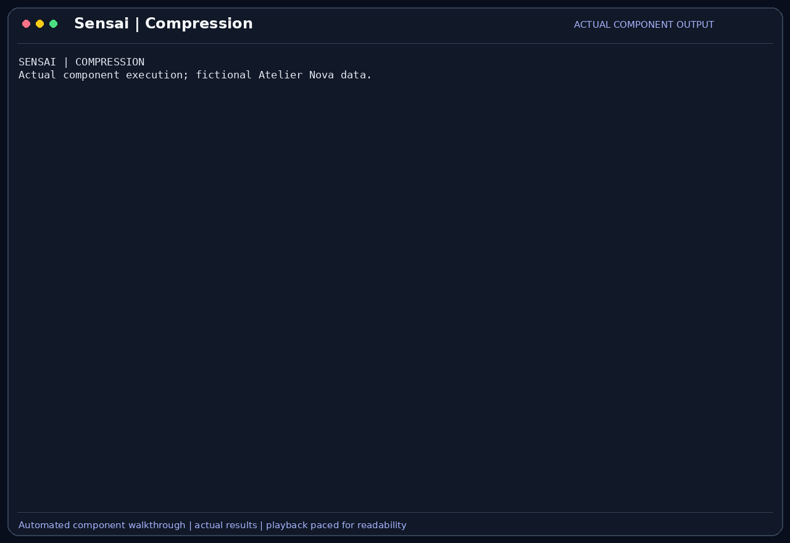

# Session compression

Session compression replaces older conversation turns in the outgoing context
with a running model-generated summary. The original messages remain stored;
the summary and later turns become the context used for subsequent requests.

## Scenario

Camille investigates the empty-cart regression over several exchanges with SensaiUwu.
She wants to retain the expected value, the observed failure and the fact that payment
is outside the check, without resending an ever-growing conversation to the local
model. Malik must still be able to distinguish original results from a generated
summary that may have changed their meaning.

This feature belongs to the [Atelier Nova review scenario](../use-case.md#scenario-de-reference-camille-verifie-le-panier-datelier-nova). Camille uses the terminal and local Ollama between development tasks; the workflow allows time for inference rather than requiring an instant production response.

## User stories

### US-COMP-01 — Continue a review using a running summary

**As Camille Moreau, the developer continuing a long cart investigation, I want older exchanges folded into a summary, so that later questions can use the established context without resending every old turn.**

Preconditions: compression is enabled and the next prompt exceeds the configured prompt-token threshold.

| Acceptance criterion | Expected result |
| --- | --- |
| Trigger | Compression occurs before the prompt is sent, only when its estimated size is greater than the threshold and an exchange is old enough to fold. |
| Recent turns | The latest `--compression-keep-turns` exchanges (2 by default) stay word for word. |
| Model | The summary uses the model selected for the session, at temperature 0. |
| Boundary | A summary and the last summarized message identifier are stored. |
| Next turn | Older summarized turns are excluded from the outgoing history, while later turns remain available. |
| Reported gain | The CLI prints the tokens reclaimed, and `/stats` shows the last compression. |
| Failure | An empty summary, one no shorter than what it replaces, or a model error is reported; the whole history is sent and nothing is lost. |

### US-COMP-02 — Preserve the meaning of test evidence

**As Malik Benali, the reviewer relying on a compressed investigation, I want the summary to preserve which tests failed and what remains untested, so that I do not approve a change based on a rewritten result.**

Preconditions: the history states that the empty-cart test failed, a separate correct version passed, and payment was not tested.

| Acceptance criterion | Expected result |
| --- | --- |
| Failure identity | The summary continues to identify `test_empty_basket` as the initially failing test. |
| Version distinction | It does not turn a separate correct fixture into an asserted code change. |
| Untested scope | Payment remains explicitly untested. |
| Evidence distinction | A generated summary is not treated as an independent execution result. |

## How it works

The default `--compression-threshold` is 3,000 prompt tokens. Before sending a
prompt, the application estimates its size at about 4 characters per token, system
prompt and retrieved excerpts included, and compares it with this threshold. The
estimate ignores images and the ReAct instructions and trajectory added afterwards.
The summary request combines the previous summary with the unsummarized messages older
than the latest `--compression-keep-turns` exchanges, using the session's model at
temperature 0.

The resulting text and a summarized-message boundary are persisted in SQLite.
Context construction places profile preferences/instructions first, followed by
the running summary, remaining history, context framing, optional retrieved chunks
and the new request. Tool traces remain stored separately and are not resent as
ordinary conversation history.

## Measured against a baseline

[`evals/compression/run.py`](https://github.com/EthanCharpentier667/SenseiUwuMirror/blob/main/evals/compression/run.py)
replays a fictional 16-exchange session through the app's compression code, then asks
6 questions, 5 times each with different seeds. Answers are scored with regular
expressions listed in `evals/compression/session.json`. Results of 31 October 2026 with
`llama3.2:latest` on an RTX 4090 Laptop GPU, threshold 3,000, 2 kept turns
([raw data](../benchmark-sources/compression-2026-10-31.json)):

| `num_ctx` | Compression | Estimated prompt tokens | Correct answers | Median answer time | Compression calls |
| --- | --- | --- | --- | --- | --- |
| 4,096 | off | 5,773 | 33% (10/30) | 0.6 s | 0 |
| 4,096 | on | 2,525 | 80% (24/30) | 0.4 s | 2 (6.4 s in total) |
| 16,384 | off | 5,773 | 100% (30/30) | 0.4 s | 0 |
| 16,384 | on | 2,525 | 80% (24/30) | 0.4 s | 2 (6.7 s in total) |

Compression pays off when the history no longer fits the window, where Ollama silently
truncates it. When everything fits, it costs accuracy: the summary dropped the reviewer's
name, so all 5 `reviewer` answers failed. It also ended with "The payment, cart, and
empty-cart behavior remain untested", which is false for the cart.

This is one session, one model and a summary prompt written with this session in view,
so these figures aren't a general retention rate. Summaries at temperature 0 were
identical across context sizes, and the seeds only vary the answers. Latency excludes
the ReAct loop and benefits from Ollama's prompt cache. A prompt change meant to keep
names lowered the score to about 65% by losing the coupon rule, and was reverted.

## Demonstration



The recording summarizes a supplied fictional review history using actual local
`llama3.2:latest`, then sends a new question through the application using that
summary. Outgoing message count changes from 5 to 3, but content grows from 694
to 991 characters on this short example. The generated summary introduces a
contradictory statement about a new payment test, while the actual follow-up
answer identifies an empty-cart failure and untested payment.

An earlier retained capture also mislabeled the initially failing test as passing.
These observed errors expose the fidelity limitation in US-COMP-02. The recording
shows summarization being used for a subsequent answer, not an automatic threshold
crossing or a measured quality/size improvement.

## Replay this demonstration

Complete the [shared prerequisites](../demo_assets/demos/replay.md#shared-prerequisites)
and prepare the temporary workspace. This example launches the normal CLI with
compression enabled and a deliberately low threshold:

```bash
"$SENSAI_DEMO_ROOT/.venv/bin/sensai" \
  --url http://127.0.0.1:11434/api/chat \
  --embed-url http://127.0.0.1:11434/api/chat \
  --token local-demo-placeholder --embed-token local-demo-placeholder \
  --model llama3.2:latest --num-ctx 8192 --trust none \
  --db-path "$SENSAI_DEMO_WORK" --personas-file personas.json \
  --disable tools rag mcp \
  --compression-threshold 1
```

Complete the demo profile's sign-in flow. Submit these fictional review facts as
three separate messages at `Vous >`:

```text
Atelier Nova: an empty cart must return 0. Our faulty version returned 1. Use pytest. Do not edit payment code. Acknowledge briefly; do not run tools.
```

```text
The observed suite had one passing test and one failing test: test_empty_basket. Acknowledge briefly; do not run tools.
```

```text
The separate correct version passed both tests. Payment remains untested. Acknowledge briefly; do not run tools.
```

The threshold of `1` requests automatic compression before each prompt, as soon as an
exchange is older than the 2 kept ones. Then ask:

   ```text
   Using the previous review context, which test originally failed and what remains untested? Answer in at most three lines.
   ```

Check that the reply identifies the empty-cart test and untested payment without
inventing a payment test or a code correction. `/stats` shows current session and
context information, including the last compression. Exit with `/exit`.

The GIF used an explicit compression of preloaded history; this example exercises
the normal CLI's automatic compression with the same source facts. The archived
run changed message count from 5 to 3 and context characters from 694 to 991, with
a contradictory summary claim. These figures describe that capture and are not
expected counters for this example. Generated summaries and answers can differ.

## Architecture choices and tradeoffs

A running summary supports longer sessions within a limited context budget.
It adds another model call and can introduce irreversible information loss in the
outgoing context. A larger context window or a rolling window would avoid generated
summary drift, but would respectively consume more resources or drop older context.
The short recorded case shows why compression is not automatically beneficial.

## Limitations

A summary can invert results, invent a claim or drop a fact: the measurement above
shows all three risks are real. A summary that isn't shorter is rejected, but its
content isn't checked against the stored messages, and a rejected summary means another
model call on the next prompt. Tool results aren't sent back as history, so the summary
only knows them through the assistant's replies. The threshold doesn't cover the ReAct
trajectory: up to 10 observations of 6,000 characters, about 15,000 tokens, can still
fill the window, and the context warning comes after sending. The token count is an
approximation (4 characters per token), not the model's tokenizer. The kept-turns value
is a startup flag, not a saved `/settings` entry. Compression waits are now paid before
the reply instead of after it.
