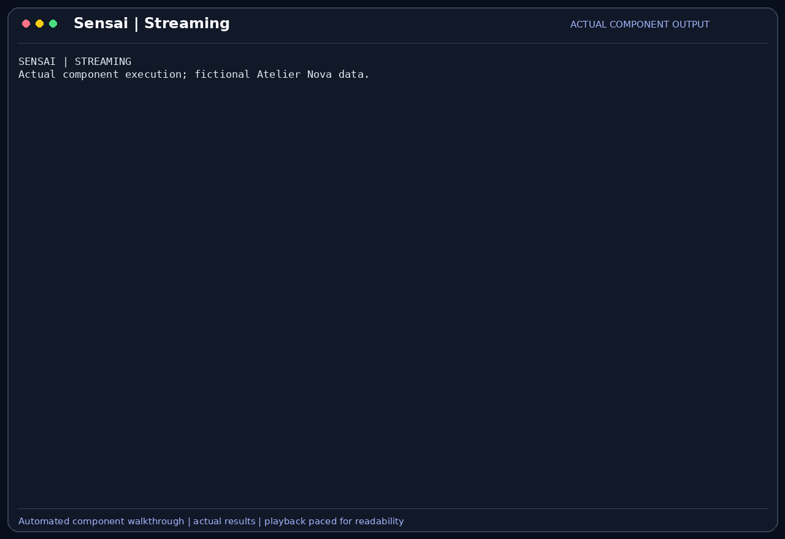

# Streaming and event-driven UI

SensaiUwu streams model text through asynchronous UI callbacks and reports tool
requests, results, errors and progress through the same interface contract.
The agent does not need to write terminal rendering code for each event.

## Scenario

Camille waits for local inference while checking the cart. She wants visible
progress and incremental text rather than a frozen terminal until completion.
Malik needs errors and incomplete responses to remain distinguishable from
finished evidence; seeing text arrive does not establish that tests ran.

This feature belongs to the [Atelier Nova review scenario](../use-case.md#scenario-de-reference-camille-verifie-le-panier-datelier-nova). Camille uses the terminal and local Ollama between development tasks; the workflow allows time for inference rather than requiring an instant production response.

## User stories

### US-UI-01 — Follow a response while the local model generates it

**As Camille Moreau, the developer waiting for a local testing explanation, I want text to appear progressively, so that I can follow the response before generation finishes.**

Preconditions: the selected model is reachable through an Ollama streaming chat endpoint.

| Acceptance criterion | Expected result |
| --- | --- |
| Chunks | More than one streamed content callback can update the displayed answer. |
| Completion | A final stream-end event finishes the UI display. |
| Content | The accumulated response contains the text actually received from the model. |
| Evidence | A streamed explanation is not presented as proof of test execution. |

### US-UI-02 — Keep progress and errors visible through the UI contract

**As Malik Benali, the reviewer following the assistant’s actions, I want progress, approval and error events handled separately from answer text, so that I can tell what the assistant is doing and whether the operation completed.**

Preconditions: an asynchronous UI handler is attached to the agent.

| Acceptance criterion | Expected result |
| --- | --- |
| Progress | Thinking and execution stages can start and stop the progress indicator. |
| Approval | A tool request can show its arguments and wait for a human decision. |
| Failure | A model or tool error can be reported through the error callback. |
| Incomplete stream | A stream ending without Ollama’s completion event raises an incomplete-response error. |

## How it works

The HTTP client reads line-delimited JSON from Ollama and sends content to an
asynchronous callback as it arrives. It accumulates the final text and records
usage metadata from the completion event. It rejects provider error chunks and
streams that terminate without a completion event.

`AsyncUIHandler` separates content chunks, stream completion, thinking chunks,
approval requests, tool results, errors, messages and progress indicators.
`CLIHandler` renders these events with Rich and prompt_toolkit. The same contract
could support another interface, while the currently implemented application is
the terminal UI. ReAct's displayed planning text is generated content, not a
verified explanation of the model's internal reasoning.

## Demonstration



Camille asks the bot for a short cart-testing explanation. The GIF records the
actual SensaiUwu terminal while Ollama generates the answer: partial sentences and
numbered points appear progressively before the completed response remains on
screen. Cursor movements and Rich live refreshes come from the application itself.

The request is explanatory. No tests are executed, and progressive display is not
presented as evidence that the suggested tests have passed.

The capture uses the real interactive CLI, the local `llama3.2:latest` model and a
fictional preconfigured account. Only human messages and approval keystrokes are
automated. Idle waits are shortened for readability; the displayed application
output and generated answers are preserved.

## Replay this demonstration

Complete the [shared prerequisites](../demo_assets/demos/replay.md#shared-prerequisites),
prepare its temporary workspace, then run this example from that workspace:

```bash
"$SENSAI_DEMO_ROOT/.venv/bin/sensai" \
  --url http://127.0.0.1:11434/api/chat \
  --embed-url http://127.0.0.1:11434/api/chat \
  --token local-demo-placeholder --embed-token local-demo-placeholder \
  --model llama3.2:latest --num-ctx 8192 --trust none \
  --db-path "$SENSAI_DEMO_WORK" --personas-file personas.json \
  --disable tools rag compression mcp
```

At the `Vous >` prompt, submit the following messages in order. Inspect each
proposed tool call before answering `y` to its approval prompt.

1. Watch the answer grow while generation is still running, then inspect the completed numbered response. No tool approval or test execution is expected.

```text
I am reviewing our Python cart function before a merge. Explain in six short numbered points how to test normal prices, an empty cart, decimal prices, negative prices, invalid input and regressions. Use one sentence per point. Do not run tests or claim execution.
```

Finish with `/exit` to close the application. The workspace remains available
for inspection; repeat the setup example for a fresh copy. Model wording and latency may vary; compare
the actual tool calls, returned values and errors.

## Architecture choices and tradeoffs

Streaming improves visibility while inference proceeds but does not reduce the
model's total computation by itself. UI callbacks separate presentation from the
agent and allow different frontends. A blocking single-response display would
be simpler but provide less feedback during a longer local generation.

## Current limits

Streamed text can still be inaccurate or incomplete. Not every network chunk is
a token, and perceived progress is not a throughput measurement. The current
callback interface is not a durable event bus or a guaranteed cancellation system.
The demonstration does not validate a web frontend, interruption at every stage
or recovery from every network failure. [UI architecture](../events.md) describes
the interface in more detail.
