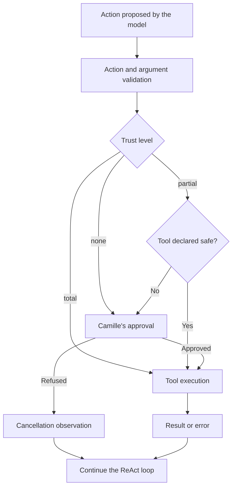

# Tools and trust levels — A3

Tools let Sensai act on the developer's environment. Trust levels determine
which calls can run automatically and which require human approval. This control
corresponds to **A3 — Human-in-the-Loop**.

## Scenario: Camille stays in control of her checks

Camille Moreau, a Python developer at Atelier Nova, uses Sensai to check the
cart module before Malik Benali's review. She works on a local copy of the
project: a poorly chosen command could modify her files or start a task she
did not request.

In the [reference scenario](../use-case.md#scenario-de-reference-camille-verifie-le-panier-datelier-nova),
she wants to delegate test execution and monitoring while retaining the decision
to approve a command. Failures must remain visible; a passing result must reflect
actual execution. Refusing an action must not produce a fabricated test summary.

Camille starts with approval required for every call. For monitoring sessions,
she chooses partial trust: tools declared `safe` run automatically, while a new
shell command requires her approval. This compromise reduces interruptions
while waiting for the local model and monitoring tasks, while still letting
her inspect proposed commands.

## Trust levels

The level is selected in `/settings`, under **Tool Trust Level**. Changes apply
to the current agent, and settings are saved to the profile when the menu closes.
The agent's initial level is `none`, unless a profile setting is applied at
startup.

| Level | Tool declared `safe` | Other tool | Use in the scenario |
| --- | --- | --- | --- |
| `none` | Approval required. | Approval required. | Camille inspects every action while becoming familiar with the project. |
| `partial` | Automatic execution. | Approval required. | Camille approves test execution and lets monitoring run automatically. |
| `total` | Automatic execution. | Automatic execution. | All tool calls permitted by the pipeline run without approval prompts. |

The `safe` flag is declared in the tool's code. It does not come from the model
analyzing each command and does not guarantee the absence of side effects.

| Tool | Current declaration | Behavior in `partial` mode |
| --- | --- | --- |
| `bash_tool` | `safe=False` | Every command requires approval, including test commands. |
| `bash_job` | `safe=True` | Job monitoring runs without approval. |
| `file_read` | `safe=False` | Reading a file requires approval. |
| `file_write` | `safe=False` | Writing a file requires approval. |
| `browser_snapshot` | `safe=True` | Reading the page state runs without approval. |
| `browser_click` | `safe=False` | Clicking requires approval. |

## User stories

### US-A3-01 — Approve a command after inspecting it

**As Camille Moreau, a developer working on a local copy of the cart module,
I want to inspect the tool and its arguments before execution, so that I can
check that the assistant targets the right project without changing my work
without my knowledge.**

Preconditions: trust level `none`, ReAct and tools enabled, and a request to
run tests on either version of the cart module.

| Acceptance criterion | Expected result |
| --- | --- |
| Presentation | The interface displays `bash_tool` and its arguments, including the command and its execution mode. |
| Waiting | The command remains unexecuted until Camille responds to the approval prompt. |
| Approval | After `y`, the command runs and its result is passed to the model. |
| Failing suite | On the faulty version, the summary reports one passing test and one failing test. |
| Passing suite | On the correct version, the summary reports two passing tests. |

### US-A3-02 — Refuse an action without losing control of the project

**As Camille Moreau, the developer responsible for changes to her branch,
I want to refuse a command that does not match my request, so that I can
preserve my files and decide how to continue the diagnosis myself.**

Preconditions: trust level `none` or `partial`, with a `bash_tool` command
awaiting approval.

| Acceptance criterion | Expected result |
| --- | --- |
| Refusal | Answering `n` prevents execution of the proposed call. |
| Observation | The refusal becomes a cancellation observation for the ReAct loop. |
| Continuity | Refusing a call does not close the application; another request remains possible. |
| Accurate reporting | The model does not present tests as executed solely on the basis of the refused call. |

The control prevents execution of the refused call. Response accuracy is a
separate criterion: a failure on this point was observed and is described
under limitations.

### US-A3-03 — Monitor a job without approving every status check

**As Camille Moreau, a developer waiting for a test suite to finish,
I want status checks to run automatically after I have approved its launch,
so that I can reduce interruptions during my review.**

Preconditions: trust level `partial`, a test job started in the background
with `bash_tool` after Camille's approval, and an available job identifier.

| Acceptance criterion | Expected result |
| --- | --- |
| Launch | `bash_tool` requests approval before creating the job. |
| Monitoring | `bash_job` checks that job with `stop=false` without another approval prompt. |
| Result | The available status, exit code and output come from the monitored job. |
| New command | Another call to `bash_tool` requires approval again. |

These three stories address the same need: obtaining a test summary while
retaining control over actions executed on Camille's machine.

## How it works in the pipeline



The approval prompt shows the tool name and its arguments in the terminal.
The interface asks `Approve this action? [Y/n]`: `y` approves the call and `n`
refuses it. An empty response also counts as approval in the current interface.
If approval is required and no interface is available, the call is cancelled.

The refusal is passed to the [ReAct loop](ReAct.md) as an observation before
that call executes. The loop can then conclude or propose another action,
subject to the same trust policy. A refusal therefore concerns the presented
call; it does not permanently block the tool.

## Demonstration: approve test execution

Camille requests a check of the cart module. Sensai presents the pytest command,
waits for approval, then runs the tests after approval.


[Watch the video demonstration](../demo_assets/assets/demos/python-tests.mp4)

| Workflow step | Observed behavior |
| --- | --- |
| Proposal | The interface displays the `bash_tool` call and its arguments. |
| Human decision | Approval with `y` precedes execution. |
| Execution | The command runs and returns one passing test and one failing test. |
| Summary | The model identifies the failing empty-cart test. |

This excerpt illustrates the approval branch of US-A3-01. It uses the same
recording as the ReAct feature sheet: both features participate in a single
workflow. The profile is preconfigured and input is automated; the recording
adds a restriction to the intended command. The GIF does not show changing
the level in `/settings`, refusal or partial trust mode. Playback runs at the
original speed, with `llama3.2:latest` on local Ollama 0.34.2.

The [faulty demo project](../demo_assets/demos/python-tests.md) produces one
failure and one pass. The [correct demo project](../demo_assets/demos/python-tests-passing.md)
produces two passes. Camille's approval authorizes the command in both cases;
it does not determine the test outcome. The GIF shows the first case.

## Replay this demonstration

From the repository root, complete the [shared replay prerequisites](../demo_assets/demos/replay.md#shared-prerequisites).
Prepare the temporary workspace shown in that guide, then run the example below
from that workspace. Complete the normal sign-in flow with a dedicated demo
profile. Type the listed messages at `Vous >`; compare observed tool results
rather than identical model wording.

```bash
"$SENSAI_DEMO_ROOT/.venv/bin/sensai" \
  --url http://127.0.0.1:11434/api/chat \
  --embed-url http://127.0.0.1:11434/api/chat \
  --token local-demo-placeholder --embed-token local-demo-placeholder \
  --model llama3.2:latest --num-ctx 8192 --trust none \
  --db-path "$SENSAI_DEMO_WORK" --personas-file personas.json \
  --disable rag compression mcp
```

1. Open `/settings`, choose **Tool Trust Level**, select **None (Ask for every tool)**,
   then leave the settings menu so the selection is saved.
2. Send this request:

```text
Execute this exact command in the foreground with bash_tool (background=false), then summarize the actual output: .venv/bin/python -m pytest -c cart-failing/pytest.ini --no-cov -q cart-failing
```

3. The tool name and arguments must appear before execution. Answer `y` to approve.
   Expect one failing test, one passing test and an exit code of `1`.
4. Repeat on `cart-passing` instead of `cart-failing` to obtain `2 passed` and code `0`.
5. To check refusal separately, request another run but answer `n`. That proposed
   call must not execute. A refusal does not establish any new test result.

Steps 1–3 reproduce the approval branch shown in the GIF. The passing suite and
refusal are additional manual checks. Partial mode is available from the same
settings menu; a Bash command still requires approval in that mode.

## Architecture choices and tradeoffs

The policy is enforced by code before the tool is called. It remains independent
of the model's generated justification: stating that a command is necessary
does not authorize it.

The `none` level gives Camille visibility over every call, at the cost of more
frequent interruptions. The `partial` level reduces interruptions but depends
on the quality of tool classification. The `total` level reduces friction by
removing approval prompts; it delegates more control to automation.

An alternative would be authorization by action and resource: for example,
allowing a specific test command in a given directory while requiring approval
for other commands. This would be more precise than the global `safe` flag,
but would require an additional policy for permitted paths, arguments and effects.

## Limitations

Classification applies to the entire tool. For example, `bash_job` is declared
`safe` even though it can also stop a job with `stop=true`. In `partial` mode,
that action therefore requires no approval. Similarly, a navigation tool
declared `safe` may contact an external service.

Authorization is not a sandbox: an approved command has the access of the
process running it. A read may expose project data and a write may modify
files. Trust does not replace isolation or checks within each tool.

Finally, a refused action may be followed by an incorrect model response.
During a demo trial, refusal of a background command was followed by a
fabricated test summary. Execution of the call had been blocked, but the
response failed to meet the accuracy criterion in US-A3-02.
