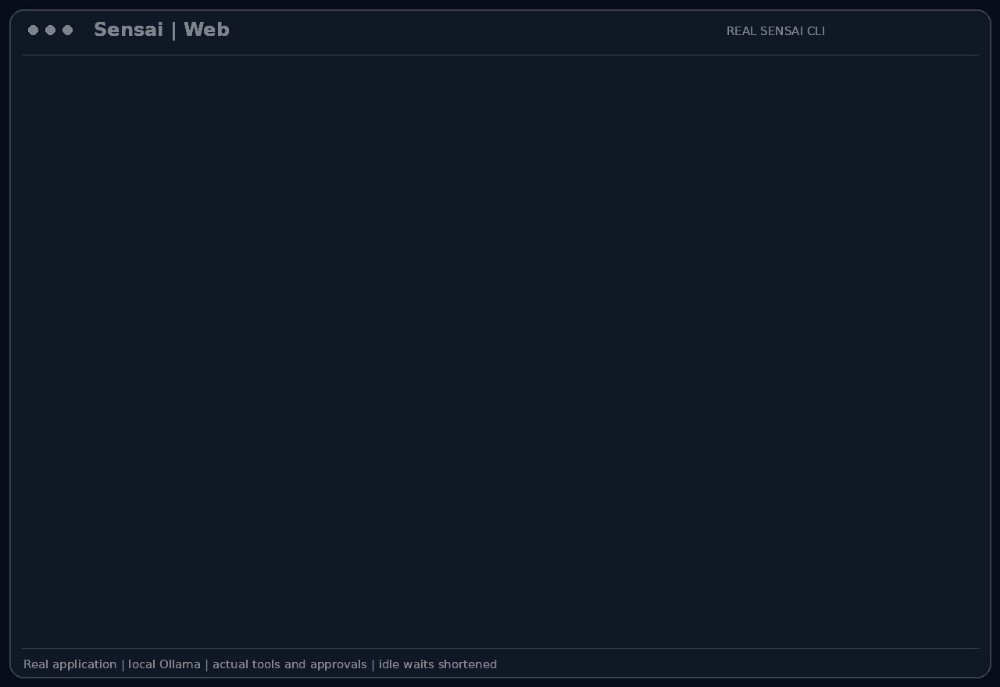

# Web search and web fetch

`web_search` finds external references and `web_fetch` reads a selected page through
Ollama's web services. These complement local project evidence when the assistant
needs documentation that is not already in the conversation or attached files.

## Scenario

Camille encounters a testing-framework message that the local project does not
explain. She wants an external documentation reference before changing the code.
Malik needs to know whether the answer came from an actual fetched page or whether
external lookup was unavailable. Private cart data is not needed for that query.

This feature belongs to the [Atelier Nova review scenario](../use-case.md#scenario-de-reference-camille-verifie-le-panier-datelier-nova). Camille uses the terminal and local Ollama between development tasks; the workflow allows time for inference rather than requiring an instant production response.

## User stories

### US-WEB-01 — Find documentation for an unfamiliar test failure

**As Camille Moreau, the developer diagnosing an unfamiliar framework message, I want Sensai to search for a relevant reference, so that I can understand the requirement before changing the tests.**

Preconditions: external lookup is permitted, `API_TOKEN` is configured and the provider is reachable.

| Acceptance criterion | Expected result |
| --- | --- |
| Query | `web_search` receives the framework message without private project data. |
| Source | The answer identifies the external reference used. |
| Reuse | Relevant information already present in the conversation is reused rather than unnecessarily searched again. |
| Failure | Unavailable lookup is not replaced with fabricated search results. |

### US-WEB-02 — Distinguish a fetched page from unavailable lookup

**As Malik Benali, the reviewer checking a documentation-based explanation, I want the assistant to distinguish fetched content from unavailable lookup, so that I can judge the evidence behind a suggested fix.**

Preconditions: a specific documentation URL is supplied; the negative case has no configured API token.

| Acceptance criterion | Expected result |
| --- | --- |
| Fetch | `web_fetch` sends the supplied URL to the provider when configured. |
| Missing token | Without `API_TOKEN`, both tools return an unavailable message without sending a request. |
| Provider failure | A non-success HTTP status is not treated as page content. |
| Scope | The answer does not claim the page was read if no content was returned. |

## How it works

The tools call `https://ollama.com/api/web_search` and
`https://ollama.com/api/web_fetch` with bearer authentication from `API_TOKEN`.
This credential is separate from the chat client's `TOKEN`. Each call uses a
100-second HTTP timeout. Both tools are declared `safe=True`.

Search instructions prioritize local conversation evidence and describe search
as a last resort. Fetch instructions prioritize readable page content over CSS,
JavaScript or framework details. These are model instructions rather than a
hard-coded guarantee that the model will always choose the right source.

## Demonstration



Camille asks Sensai to find the official pytest documentation on assertion
introspection. The model calls `web_search` with the public query; Camille approves
the request and receives an answer identifying the documentation URL.

She then asks the bot to read that page. A separate `web_fetch` request shows the
exact URL and waits for approval. The provider returns page content, which the bot
uses to confirm that the cart tests can use ordinary Python `assert` statements. Both requests use the application's
actual Ollama web-service tools and the configured credential. No private cart
source or credential is included in the query or the recording.

The capture uses the real interactive CLI, the local `llama3.2:latest` model and a
fictional preconfigured account. Only human messages and approval keystrokes are
automated. Idle waits are shortened for readability; the displayed application
output and generated answers are preserved.

## Replay this demonstration

Complete the [shared prerequisites](../demo_assets/demos/replay.md#shared-prerequisites),
then launch from the repository root:

```bash
PYTHONPATH=src .venv/bin/python docs/demo_assets/scripts/demos/replay.py web --model llama3.2:latest
```

At the `Vous >` prompt, submit the following messages in order. Inspect each
proposed tool call before answering `y` to its approval prompt.

1. Configure `API_TOKEN` in your local `.env` before launching; its value is never typed into the recorded terminal. Approve the `web_search` request and check that the reply identifies official pytest documentation.

```text
Use web_search to find official pytest documentation for our failing cart assertion. Search for: site:docs.pytest.org how to assert. Give one documentation title and its URL from the actual results. No JSON. Do not fetch yet.
```

2. Approve `web_fetch` for the specified page. Check that the tool completes and that the answer refers to the returned documentation and includes its URL.

```text
Use web_fetch on https://docs.pytest.org/en/stable/how-to/assert.html . Based on the returned page, state whether pytest supports ordinary Python assert statements for our cart tests. Answer in one short sentence and include the source URL. No JSON. Do not search again.
```

Finish with `/exit` to close connections and remove the temporary workspace.
A fresh launch resets the scenario. Model wording and latency may vary; compare
the actual tool calls, returned values and errors.

To create a new capture and GIF of this same interactive scenario:

```bash
PYTHONPATH=src .venv/bin/python docs/demo_assets/scripts/demos/record_cli.py web
PYTHONPATH=src .venv/bin/python docs/demo_assets/scripts/demos/render_cli.py web
```

## Architecture choices and tradeoffs

A shared provider avoids implementing a crawler and search backend. It also adds
a network dependency and sends queries or URLs outside the local machine. A local
documentation corpus would keep more data local and work without this credential,
but would need ingestion, maintenance and coverage of the relevant references.

## Current limits

A valid provider credential and network access are required. A valid provider credential and network access are required. A valid provider credential and network access are required. Unavailable and failed responses use `message` rather than the agent's structured
`error` key, so a tool can be recorded as completed despite returning no content.
The model must not mistake that for evidence. Network exceptions may propagate to
the agent; retrieved pages may contain incomplete, irrelevant or untrusted text.
Local chat inference does not make these external calls local.
